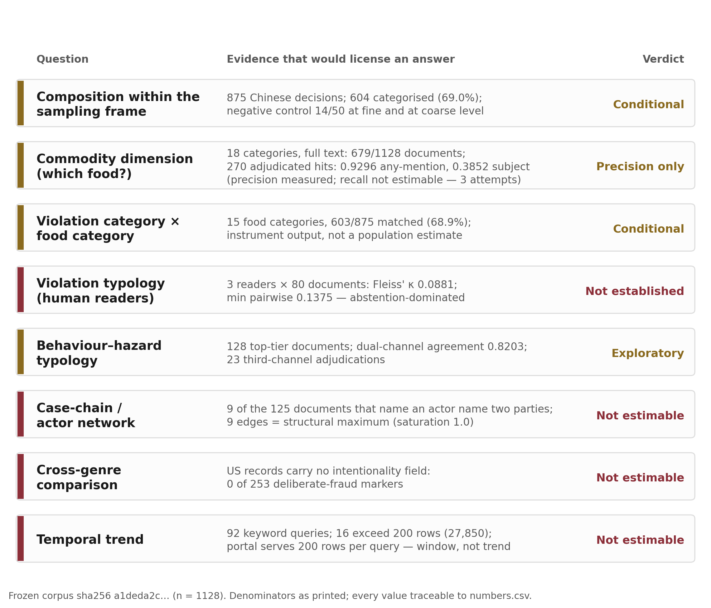

# What Administrative Penalty Documents Measure: A Validation Audit of Food-Safety Enforcement Data in China

Yongjin Chen^1^, Chenrui Yang^1^, Ziying Xue^1^, Xiyuan Wang^1^ and Songze Zhu^1^,\*

^1^ People’s Public Security University of China, Beijing, China; 202420610006@stu.ppsuc.edu.cn (Y.C.); 2024111033@stu.ppsuc.edu.cn (C.Y.); 15620821066@163.com (Z.X.); 202321440020@stu.ppsuc.edu.cn (X.W.)

\* Correspondence: 20196846@ppsuc.edu.cn

**Article type:** Original Research

---

## Abstract

**Background:** Administrative penalty decisions are China’s most abundant machine-readable record of food-safety enforcement, but they have never been validated as a measurement instrument. Studies that count them treat publication as evidence that the conduct occurred. We test that assumption on a frozen corpus and audit the dimension food research needs most: which food a case is about.

**Methods:** The corpus holds 1,128 documents: 875 Chinese penalty decisions from the national publication portal and 253 US recall records from openFDA. A deterministic statute map assigns coarse categories. Two independently prompted channels of a locally served Qwen2.5-7B model annotate entities and violation categories. A statute anchor set of 423 documents supplies accuracy estimates. A pre-registered 18-category lexicon was adjudicated on 270 sampled hits, and three readers coded 80 documents.

**Results:** The two channels agree on 0.7460 of documents, which is reliability rather than accuracy; statute-anchored micro-F1 is 0.7825 and macro-F1 0.4195 over classes with support ≥ 20. The statute map places 604 of the 875 Chinese decisions in a coarse category. The lexicon matches 679 documents. Adjudication gives any-mention precision 0.9296 but subject-matter precision 0.3852, because most matches sit in ingredient lists or quoted statute. Three readers reach Fleiss’ κ 0.0881, and three pre-registered attempts to automate the commodity role all miss the same gate (best κ 0.4885, balanced accuracy 0.7390). The rule layer agrees with the independent channel on 14 of 50 documents at both granularities.

**Conclusions:** Composition within the sampling frame is reportable with its instrument attached. Prevalence, trend and case-chain structure are not. The commodity audit is a warning about how such tables are built, not a table of prevalence.

**Keywords:** food fraud; administrative penalty documents; measurement validity; automated annotation; food safety governance; estimability

---

## Introduction

Food-safety fraud often leaves no hazardous product behind, only a false document: a forged inspection report, a mislabelled ingredient list, a borrowed certification mark, a fabricated traceability record. Conduct of this kind attacks the informational layer that regulation depends on. Reviews of it report terminologies and populations that differ from study to study {robson2021}, and that heterogeneity matters for measurement, because a count is only as good as the construct it counts.

Administrative penalty decisions are among the most abundant structured public records of these events in China. Agencies publish the legal basis they invoked, a narrative of facts and the sanction imposed; the categories are produced by law rather than by a researcher, and the volume is large enough to support distributional statements if the text can be processed at scale. For food-safety research the question narrows. Whether a case is a case of food fraud is one matter; whether the food it concerns can be read out of the document at all is another, and it is the second that decides whether this record can serve the field.

Two obligations follow, and the literature has not always discharged them. Automated extraction from legal prose has to be validated against something other than itself: agreement between two automated passes is a reliability statistic, and reliability is not accuracy, which concerns the construct the codes refer to {jacobs2021}. The genre also constrains what can be inferred from it. A single-document decision names the sanctioned party and the agency; it rarely names the chain of intermediaries a forged certificate travelled through. A portal that serves a fixed number of rows per query cannot support a prevalence estimate, however many documents it holds in total.

The third obligation is specific to food. Studies of food fraud want to know which foods are involved, and a text pipeline can supply that only if the food dimension is measured rather than assumed. Lexical categories are usually attached without an audit of what a match means, yet a term that occurs in a case is often not the commodity the case is about.

Four bodies of work bear on the question, and none of them closes it. Food fraud is defined by intent (deception for economic gain) rather than by hazard, which fixes what any count of it means {spink2011}. The most systematic record-based evidence, a four-decade curated database, supports statements about the composition of recorded incidents while remaining a record of what was detected rather than of what occurred {everstine2024}. Chinese enforcement data have been analysed in a data-driven preprint {gao2020} and modelled to predict at-risk products {soon2020}. A second strand uses violation records with institutional covariates (regional character, restaurant size, regulatory decentralisation, street-level capacity) and asks about enforcement behaviour rather than about what the documents measure {sha2020,lin2024,yee2021}, with governance reviews describing the institutional setting {kang2019}. Comparable work reads judicial and enforcement records elsewhere for a national picture {macheka2026}, and a cross-country comparison locates variation in meso-institutions, comparing constructs rather than rates and never asking whether two record genres can support a common one {menard2024}. A legal-doctrinal literature asks whether penalty decisions should be disclosed at all {liu2022}.

Where enforcement text is coded at scale, the question is what licenses the codes. Legal-text analytics on 782 Indian food-violation judgments from 2022–2024 reports counts without a validation layer {joshi2025}. Dictionary and supervised methods are well characterised, but their validity depends on the category scheme they are given, which is why text-as-data work treats measurement as a design choice rather than a preprocessing step {gentzkow2019,grimmer2013}. Language models sharpen the point: their labels move with contextual cues {vallejo2025}, and here the same model both annotates and judges. The commodity dimension has the same shape of problem. Food-fraud research is organised around commodities and supply-chain nodes, and prevention is built on vulnerability assessment {barrere2020}, yet food dimensions are usually attached by lexicon and reported without an audit of what a match denotes. We located no study reporting an adjudicated precision for the food dimension of an enforcement corpus, or separating the commodity a case is about from the commodities the document mentions.

One question therefore remains open: whether penalty-decision text can be used as a measurement instrument, and what its food dimension denotes. We answer it by auditing rather than assuming. Three things come out of the exercise: a provenance arrangement in which every statistic resolves to a product file, a field, a timestamp and a hash, so that a reader can check a number without trusting the prose around it; a distinction the food-dimension literature lacks, any-mention precision against subject-matter precision, adjudicated on 270 hits, which separates the 0.9296 of matches that denote the category from the 0.3852 that are about it and turns the commodity table into a warning; and a ladder of estimability that fixes which questions this genre can answer, with the reason attached to each. Composition within the sampling frame is reportable with its instrument attached; the food dimension is measurable in precision; prevalence, trend and case-chain structure are not estimable. We claim no national prevalence, no change over time and no cross-jurisdiction rate, because in each case the instrument or the frame would be doing the work.

## Materials and methods

### Sources and sampling frame

We collected Chinese documents from the national food-safety penalty publication portal of the State Administration for Market Regulation, using 92 keyword queries built from the project’s fraud lexicon: forged, mislabelled, certification-mark misuse, tampered, substandard, unlicensed, and combinations with “food”. Two properties of the portal shape what such a collection can mean, and we recorded both as a product (`data/reports/portal_mechanics.json`, 2026-11-05T04:54:41Z). Results are served in publication-date-descending order, and at most four pages of fifty rows per query are reachable: across three queries pages 1–4 returned 50 rows each while pages 5 and 6 returned zero, the 50 dates on page 1 of one query ran from 2026-10-19 to 2026-09-30 with no increase, and page 4 of another ended at 2026-01-15.

The corpus is therefore the union of the most recent rows of each query under the portal’s default ordering. Sixteen of the 92 queries reported more than 200 matching records, totalling 27,850, whereas no single query registered more than 201 documents in our corpus (174 of 6760 for one query, 88 of 5260 for another). The frame is documented and reproducible, but it is recency-weighted, and every result that could be misread as a population figure is marked as such.

Documents entered and left the corpus through a recorded funnel: 3,540 records entered the database; 2,091 were removed by the source-relevance screen; 296 retained metadata but no retrievable full text; 25 were rejected at the annotation protocol stage; 1,128 labelled documents remained, 875 Chinese penalty decisions and 253 US recall records. The 25 that failed the protocol are longer than the labelled set (median 6,136 characters against 3,578, a ratio of 1.71 on the same column), whereas the 296 never received text and are missing rather than short. Both groups return in the limitations.

The 253 English-language documents are recall records from the openFDA food-enforcement database, a source already used to analyse recall severity {chen2026}. A recall record classifies a hazard and a recalling firm and has no field for intentional falsification. Collecting such records automatically raises legal and ethical questions, which we met by query-level rate limiting and by redistributing a document index rather than the documents {luscombe2022}.

### Deterministic rule layer

Two rule systems run before any model sees a document. A statute-to-category map (version 2) assigns each document to one of nine fine-grained categories that collapse into five coarse ones (data falsification, market order, unlicensed operation, procedural non-compliance, undetermined), and a food-category lexicon (version 1) assigns up to one primary and several secondary categories from a 15-category vocabulary plus an unmatched bucket. Both read only the penalty-clause and fact paragraphs, never the full document: boilerplate mentions statutes and food terms irrespective of the case, and full-text matching inflates every count.

We cross-checked the deterministic layer against the language-model layer on a random 50-document slice (seed 20261104). This is an agreement check, not a validation: the model layer is the same model under a different prompt, and no human annotation of these categories exists. Exact-category agreement was 0.28 against both model channels, against a same-model cross-channel agreement of 0.74 on the same slice. The pre-registration said that a dimension with agreement below 0.75 should be reported only at the coarse level; tested with the frozen coarse map, that presumption does not hold. The same 14 of 50 documents agree at fine and at coarse granularity, agreement conditional on the rule having decided anything is 14 of 32 (0.4375), and the 18 documents it declines to classify are all disagreements. Coarse reporting is not validated either, and the results report it as instrument output with its negative control attached.

### Language-model annotation

Annotation runs on a locally served Qwen2.5-7B-Instruct model through vLLM, with two independently prompted channels (A with an α-prompt, B with a β-prompt) that label six entity types (service provider, end user, tactic, document, jurisdiction, penalty event) and a violation category. Input is capped at 20,000 characters and no document reached the cap (labelled median 3,151 and p99 9,705 characters, a different column from the 3,578 above); answer budgets were 3,000 and 4,000 tokens; spans match at a character threshold τ = 0.5. Language models are increasingly proposed as annotators {ziems2024}, which is why their agreement is reported here as reliability and nothing more.

Agreement between the channels is 0.7460 over the full corpus (n = 1128), 0.7257 for Chinese and 0.8158 for English documents, with pooled micro-F1 0.7442. Sensitivity to the threshold is flat (0.7487 at τ = 0.3, 0.7460 at τ = 0.5, 0.7276 at τ = 0.7), so τ is not doing inferential work. A pre-registered single-pass protocol (one pass per document, no self-consistency, no ladder) gives 0.6966 on the 1,037 documents for which a single-pass vote exists (reconstructed for 638 from archived single-shot outputs; 91 had no archived copy and are excluded rather than imputed). The type-shrinkage ladder retains a type only if its per-type F1 reaches 0.75 with support of at least 20; three survive (END_USER, JURISDICTION, PENALTY_EVENT) and agreement on that restricted set is 0.8610. The three figures measure different things and are never substituted for one another.

### Statute-anchored evaluation

Agreement between two channels of one model cannot establish accuracy, so we built an anchor set: 423 documents whose penalty clause cites a statute in the mapping table. Evaluating a test when no gold standard exists is a recognised problem with recognised partial remedies {rutjes2007,collins2014,umemneku2019}; the anchor is ours, external to the model channels but sharing the rule layer’s reading of the penalty clause, so it measures the model channel and yields no accuracy estimate for the rule layer. A further 97 documents cite a statute but carry no rule-legible fact paragraph and are excluded, with the exclusion recorded in the evaluation product rather than dropped silently. Anchors come from a penalty statute (232 documents), a cited statute (52) and a statute plus explicit facts (139). The set yields micro-F1 0.7825, macro-F1 over all classes 0.2693, and macro-F1 over classes with support ≥ 20 of 0.4195.

Per-class performance is reported with support and prediction counts, since the macro figure is otherwise unreadable: FALSE_LABELING F1 0.8801 (support 326, predictions 383); UNLICENSED_OPERATION 0.3784 (52, 22); FORGED_INSPECTION_REPORT 0.3571 (11, 17); OTHER 0.0 (31, 0). Two classes have support below 3 and contribute zero, and OTHER’s zero is not a rounding artefact: the instrument issued no OTHER predictions against 31 anchored documents.

### Commodity-term audit

The food dimension of this corpus had never been measured, so we measured it. The audit is a document-level, literal presence test over the cleaned full texts of all 1,128 documents, not a classifier. Its lexicon of 18 commodity categories, listed in Table 3, was registered before any count was taken and not edited afterwards. Matching is a substring test on the raw text with no tokenisation, no wildcards and no case or variant folding, the simplest rule a reader can re-execute; the results report what that simplicity costs.

Two properties matter. The unit is the document, and the value is whether at least one term of a category occurs anywhere in it, header included: the measure says “this document mentions the category”, never “this case concerns it”. Absence means only absence of the string, so no category may be read as a denominator of non-occurrence.

To measure what a match means we adjudicated a sample drawn by a rule fixed in advance: within each category, documents were sorted by the sha256 of their identifier and the first fifteen taken (270 documents; equal allocation, since every category had at least fifteen hits). Each hit was read in a ±120-character window, and in the full document where the window was not decisive, and assigned one of four verdicts. **Subject**: the term names the commodity the case is about. **Mention**: it occurs but not as the case subject: an ingredient list, a menu component, a business scope, a neighbouring product. **Statute**: it occurs only inside quoted law or standard text, a subset of mention recorded separately. **False**: it does not refer to that category at all. That covers a place or company name, a homograph and a cross-word-boundary artefact; worked examples are in the supplementary adjudication file. The registered pass test counts subject, mention and statute as passes; the draw is deterministic, so each precision carries a binomial approximation rather than a design-based interval, and two precisions are reported, neither called “the precision”. Three non-food control terms (battery, boiler, platform scale) are reported alongside.

Because the audit measures precision only, we also tried to obtain the commodity role for every document, which is what recall would require. Three constructs were registered before they ran, against a gate fixed before the first call: agreement with the same 270 adjudicated items of at least κ 0.60 and balanced accuracy of at least 0.75, both chosen because the gold is imbalanced. The results report all three and the cap the third carried.

### Human reliability check of the violation typology

Six violation categories had never been checked against human readers. Three readers coded the same 80 documents through three administrations of one codebook in the same session channel, rather than as three independent teams. Fleiss’ κ {fleiss1971} is the primary statistic, with cut-points from conventional benchmarks {landis1977} and a verdict rule fixed before the result: minimum pairwise agreement 0.80 with a Wilson lower bound of 0.70 and κ of 0.60 would support a shared reading; κ below 0.40 or minimum pairwise agreement below 0.60 would support its absence. Because κ credits mutual abstention as agreement and moves with the marginal distribution it is computed over {byrt1993}, we also decompose each pairwise agreement into mutual abstentions and substantive agreements.

### Reproducibility

The pipeline is a single command set with per-stage receipts, the corpus is frozen and content-addressed, and every statistic in this paper is generated by a script that records the product file, JSON field, product timestamp and product sha256 into a machine-readable sheet. Design deviations, including every one that affected a reported number, are kept in an append-only register (`DEVIATIONS.md`) alongside the provenance sheet that licenses every number (`numbers.csv`). We treat that register as a result rather than housekeeping: pre-registration is what lets a reader distinguish a hypothesis tested from a hypothesis told afterwards {nosek2018,chambers2013}, and the register records its own corrections in the same place. Analyses run after the freeze name their input file, and the chain resolves to the corpus: the negative-control product reads the E6 product, which stamps `silver.sha256 = a1deda2c…` and `n = 875`. A post-freeze analysis that weakens a claim, as the coarse-granularity negative control and the commodity audit both do, is reported for the same reason.

## Results

### Agreement, accuracy, and what each number measures

Table 1 collects every statistic the results use, with its denominator and the product file it comes from. The instrument is reliable on three entity types and one dominant category, and unusable on the two types a case-chain analysis would need. Per-type F1 separates cleanly: END_USER 0.9105, JURISDICTION 0.8809 and PENALTY_EVENT 0.8606 are extracted consistently by both channels, while TACTIC (0.6279), DOCUMENT (0.4097) and SERVICE_PROVIDER (0.3356) are not. These are agreement figures, not correctness figures, and no human adjudication of entity spans exists; the case-chain analysis fails for a reason we can measure.

At the category level FALSE_LABELING (326 anchors) is recovered well and rare categories are not. Macro-F1 over all classes (0.2693) is therefore not a statement about the instrument, being dominated by two classes with support 1 and 2; macro-F1 over classes with support ≥ 20 (0.4195) still averages a structural zero, because OTHER has support 31, receives no predictions, and enters the mean as 0. Dropping the never-emitted class raises the figure to 0.6292. We report all three (0.2693 / 0.4195 / 0.6292) with the class list, because the gap between the last two is a property of the threshold and the vocabulary rather than of accuracy.

**Table 1.** Measurement layer: what each statistic measures, on which denominator, from which product.

| Statistic | Value | Denominator | What it measures | Product |
|----------------|------:|----------|----------------------|----------------------------------|
| Two-channel agreement (post-ladder mix) | 0.7460 | 1128 | reliability, not accuracy; mixes 729 self-consistency and 399 single-shot documents (e1 status: failed, < 0.75) | `data/metrics/e1.json` |
| Same, stable types only | 0.8610 | 1128 | reliability on 3 of 6 types | `data/metrics/e1.json` |
| Pre-registered single-pass agreement | 0.6966 | 1037 (91 lost) | reliability, no ladder | `data/metrics/e1_preladder.json` |
| Anchor micro-F1 | 0.7825 | 423 | accuracy vs statute anchors | `data/metrics/e1.json` |
| Anchor macro-F1, classes with support ≥ 20 | 0.4195 | 3 classes, pooled support 409 (326 + 52 + 31) | accuracy, excluding unlearnable classes | `data/metrics/e1.json` |
| Anchor macro-F1, all classes | 0.2693 | 423 (6 classes) | dominated by support 1–2 classes | `data/metrics/e1.json` |
| Rule vs LLM agreement (cross-check) | 0.28 | 50 | agreement with one LLM channel; not a validation | `data/analysis/e6_descriptive.json` |
| Commodity term presence, any-mention precision | 0.9296 | 270 adjudicated hits | does a matched term denote that food category at all | `data/analysis/e12_commodity_precision.json` |
| Commodity term presence, subject-matter precision | 0.3852 | 270 adjudicated hits | is that commodity the product the case is about | `data/analysis/e12_commodity_precision.json` |
| Violation typology, three readers | 0.0881 | 80 documents × 3 readers | Fleiss’ κ; shared reading not established | `data/analysis/e11c_three_coder.json` |

### Coarse composition of the Chinese corpus

Table 2 gives the coarse composition and the composition of its dominant class. The deterministic layer assigns a coarse category to 604 of the 875 Chinese documents and leaves 271 undetermined, and every figure it produces is instrument output rather than an estimate. Data falsification went to 412 (68.2% of categorised documents, 47.1% of all), market order to 100, procedural non-compliance to 66, unlicensed operation to 26. The dominant class is not homogeneous: 375 of the 412 are false labelling (0.9102), 33 forged inspection reports and 4 fake certification, so the headline category describes documentary mislabelling much more than forgery. The layer’s negative control is 14 of 50 documents at both granularities. No statement about prevalence in the population is made or implied.

The 271 undetermined documents cite no statute in the mapping vocabulary, or one outside the five-category framework; within that residual, 100 invoke no mapped statute at all, of which 19 invoke only the Administrative Penalty Law, a formal rather than a substantive basis. A hard mapping would count conduct outside the construct as inside it, so we report the residual instead.

Extractable fines are available for 565 of 875 documents, with a median of 5,000 CNY (p25 1,700; p75 15,000; p90 55,000; maximum 805,231). We report them without modelling, because the sanction is set by a statutory band whose lower bound depends on the value of the goods, which decisions rarely state in machine-readable form.

**Table 2.** Coarse violation composition of the Chinese corpus, and the composition of its dominant class (n = 875; frozen corpus `a1deda2c…`). Every count is the deterministic layer’s output; the negative control for that layer is 14 of 50 documents at fine and at coarse granularity alike.

| Coarse category | Documents | Share of categorised | Composition |
|----------------------|---------:|---------------|--------------------------------------------|
| Data falsification | 412 | 0.6821 | false labelling 375, forged inspection report 33, fake certification 4 |
| Market order | 100 | 0.1656 | trademark infringement, false advertising, product quality |
| Procedural non-compliance | 66 | 0.1093 | no mapped substantive statute |
| Unlicensed operation | 26 | 0.0430 | unlicensed production or operation |
| **Categorised total** | **604** | **0.6903 of 875** | — |
| Undetermined | 271 | — | 100 cite no mapped statute, 19 only the Administrative Penalty Law |

### What a commodity term denotes

The commodity audit speaks most directly to food research, and its result is a warning rather than a table of prevalence. Over all 1,128 documents, 679 contain at least one term from the 18-category lexicon and 449 contain none; condiments occur in 163 documents, fresh meat in 137, grains in 111, aquatic products in 100 (Table 3).

Adjudicating the 270 sampled hits shows why those are not counts of cases about those foods. Of the 270, 104 name the commodity the case is about, 121 mention it in another capacity, 26 occur only inside quoted statute or standard, and 19 are outright false matches. Precision against the registered pass test is 0.9296 (95% CI 0.8927–0.9545) on the equal-allocation sample and 0.9404 reweighted by corpus size; subject-matter precision is 0.3852 (0.3291–0.4445) and 0.3636 respectively. The equal-allocation figures are not corpus proportions; the per-category columns are the primary result.

Three things bear on anyone building a food dimension onto enforcement text. The 19 false matches are not semantic misjudgements and not one phenomenon: seven are place or company names (Hulunbuir, Nanjing Tai’er Sauerkraut), four are word-boundary substrings (*jinguihua* plus “production date” yielding the string for peanut), two are chemical names, and six are flavour words in hard candy and cake, which are not dairy in any sense a food scientist would accept. The enumeration is in the supplementary adjudication file, and only a commodity-role test removes all four kinds.

Two categories are almost entirely statutory. Of 15 sampled hits in health food, 4 occur only in quoted provisions; of 15 in foods for special dietary uses, 13 do. Those presences record which decisions quote the relevant article, and the subject-matter counts are 1 and 1 out of 15 (precision 0.0667 both). Condiments show the same pattern for a different reason: they are ubiquitous in ingredient lists, so 163 documents mention them while only 2 of 15 sampled hits are about a condiment as the product (precision 0.1333).

The categories that survive do so at very different strengths: soy products reach 0.9333 and alcoholic drinks 0.8667, bakery and meat products 0.6000, and dairy, fruit, fresh meat and grains sit between 0.2000 and 0.3333, because a meat or dairy term in a mislabelling decision is usually the ingredient mislabelled rather than the product sold. The negative control confirms the corpus is not purely food-related: the three non-food terms occur in 2, 2 and 1 documents, and 3 documents contain a non-food term and no commodity term at all.

Word segmentation does not rescue the lexicon. Re-running the 18 term lists with a token-boundary rule (jieba 0.42.1, default mode, no user dictionary) moves the corpus total from 679 to 634, with no document gained, so the segmented rule is a strict subset. On the 270 adjudicated hits it drops 38: 8 of the 19 false matches, which is what segmentation is for, 12 of the 104 true subjects, 13 mentions and 5 statute citations. Subject-matter precision moves from 0.3852 to 0.3966 (92 of 232), a gain of 0.0114. The losses concentrate in short terms: the term for fish is lost in 52 documents because *carp* and *squid* are single tokens, and a case about carp is a case about an aquatic product. Segmentation repairs the boundary artefacts and not the problem that dominates the table.

**Table 3.** Commodity-term audit. Presence is a literal substring match over the cleaned full text of each document (n = 1,128); precision is measured on the first 15 documents of each category in sha256(identifier) order, read in ±120-character windows and adjudicated. “Any-mention” counts a match as a pass when the term denotes the category in any capacity; “subject” counts it only when the commodity is the product the case is about. Equal-allocation precisions are not corpus proportions.

| Commodity category | Documents with term | Sampled | Subject | Any-mention precision | Subject precision |
|--------------------|------------|--------:|--------:|--------:|--------:|
| Condiments | 163 | 15 | 2 | 1.0000 | **0.1333** |
| Fresh meat | 137 | 15 | 4 | 1.0000 | 0.2667 |
| Grains and their products | 111 | 15 | 4 | 1.0000 | 0.2667 |
| Aquatic products | 100 | 15 | 5 | 0.8000 | 0.3333 |
| Bakery | 86 | 15 | 9 | 0.9333 | 0.6000 |
| Confectionery and roasted nuts | 85 | 15 | 8 | 0.9333 | 0.5333 |
| Alcoholic drinks | 82 | 15 | 13 | 1.0000 | 0.8667 |
| Meat products | 72 | 15 | 9 | 1.0000 | 0.6000 |
| Edible oils | 70 | 15 | 3 | 1.0000 | 0.2000 |
| Fruit and fruit products | 69 | 15 | 3 | 0.7333 | 0.2000 |
| Health food | 66 | 15 | 1 | 1.0000 | **0.0667** |
| Beverages and frozen desserts | 56 | 15 | 8 | 1.0000 | 0.5333 |
| Vegetables and their products | 54 | 15 | 4 | 0.8000 | 0.2667 |
| Dairy | 49 | 15 | 5 | 0.7333 | 0.3333 |
| Eggs and egg products | 39 | 15 | 6 | 1.0000 | 0.4000 |
| Soy products | 35 | 15 | 14 | 0.9333 | **0.9333** |
| Foods for special dietary uses | 32 | 15 | 1 | 1.0000 | **0.0667** |
| Tea | 24 | 15 | 5 | 0.8667 | 0.3333 |
| **All categories** | **679** | **270** | **104** | **0.9296** (0.8927–0.9545) | **0.3852** (0.3291–0.4445) |

*Source: `data/analysis/e12_commodity_index.json` (2026-11-05T07:50:39Z, sha256 `52e3ca41…`) and `data/analysis/e12_commodity_precision.json` (2026-11-05T07:54:11Z, sha256 `11108382…`). **Three rows are not commodity spectra and are bold: condiments (15), health food (16) and foods for special dietary uses (18) have subject precisions of 0.1333, 0.0667 and 0.0667, dominated by ingredient lists and by quoted statute respectively, so only their subject counts, 2, 1 and 1 out of 15, may be read as cases about the commodity.** The 19 false matches are 7 proper names, 6 flavour words, 4 cross-word-boundary substrings and 2 chemical names; 26 further hits occur only inside quoted statute or standard text and count as passes. Three non-food control terms (battery, boiler, platform scale) occur in 2, 2 and 1 documents.*

### Three attempts to automate the commodity role

The commodity role is not recoverable by asking a served 7B model nicely. Three pre-registered constructs, each plausible on its own terms, all failed the same gate (Table 4). The audit above measures precision and nothing else, whereas recall (the share of cases about a given food that the lexicon recovers) needs the subject of every document, and a literal term list cannot supply it: a decision naming only a brand, an alias or a product type outside the list is invisible to it. We therefore asked the model, under the same gate. Since 104 of 270 adjudicated items are subjects, raw accuracy would reward a model that answers “no” everywhere.

The three attempts are three constructs, not three settings of one: a forced 18-way choice (E13), eighteen per-category yes/no questions (E15), and a free-text product name mapped by the frozen lexicon in code, identically for every document (E16). Each was registered before it ran, and the third carried a cap fixed in advance: no further construct, model or format would be tried after it. The cap bounds this pipeline, not the class of models.

Each attempt fails in a different place. The best κ and the best balanced accuracy are E15’s, the best specificity E16’s, the best sensitivity E15’s. Changing a forced choice into per-category binaries moved κ by +0.1644 and sensitivity by +0.1923 while specificity barely moved (−0.0180): a substantial part of E13’s blindness was produced by the format, since a model forced to pick one of eighteen categories will answer rather than abstain. That is not enough of the effect for the question to survive, because 0.4885 is far from 0.60 and 0.7390 is below 0.75. The format is a real variable; it is not the explanation.

E16 fails elsewhere, and saying where is the point of running it. The model produced a name for 896 documents and declined in 232. The names are recognisable commodities (牛栏山陈酿酒, 黄桃罐头, 贵州茅台酒, 秘制红油), yet 586 of the 896 (0.654) contain no lexicon term at all, so the mapping assigns them category 0 and they count as negative. The bottleneck is binding, not extraction: a literal term list cannot receive a brand name. We did not hand-map those 586 phrases after seeing the gate, which would have replaced the instrument whose failure had been measured, and it would not have tested whether the model identifies the subject.

Recall of the commodity axis is therefore not estimable, and no figure may be read as a share of cases. That consequence is applied throughout: the commodity table is ordered by mentions, the cross-tabulation below is bookkeeping, and Figure 1 prints “measured” and “not measured” side by side. The 449 documents with no commodity term are the clearest case. An unknown share of them is about some food, and no sample can be adjudicated by one reader at the reliability this paper demands of three. A number produced by one reader where three reached κ 0.0881 would wear the costume of a measurement.

**Table 4.** Three pre-registered attempts to identify the commodity a case is about, each validated against the same 270 adjudicated items and the same gate (κ ≥ 0.60 and balanced accuracy ≥ 0.75, fixed before the first call). The gate was never moved, and no attempt changed the gold standard, the corpus or the threshold.

| Attempt | Construct | κ | Balanced accuracy | TPR | TNR |
|-------|----------------------------|--------:|-----------:|-------:|-------:|
| E13 | forced choice, 18-way single selection | 0.3241 | 0.6519 | 0.4423 | 0.8614 |
| E15 | 18 per-category yes/no questions | **0.4885** | **0.7390** | **0.6346** | 0.8434 |
| E16 | free-text product name, mapped by the frozen lexicon | 0.3888 | 0.6766 | 0.4135 | **0.9398** |

*Source: `data/analysis/e13_commodity_subject.json`, `e15_validation.json` (sha256 `5b961f5c…`) and `e16_validation.json` (sha256 `0e560f5a…`); 270 items each, 0 unparseable, 0 duplicates, no document truncated at the 12,000-character cap. The three attempts differ in construct and, for E15 and E16, in whether the document precedes the question.*

### Human readers and the violation typology

Three readers working from one codebook do not share the six-category typology. Fleiss’ κ over the three is 0.0881, with a minimum pairwise agreement of 0.1375, and by the rule fixed in advance that is a verdict of no shared reading on 80 documents.

The pairwise figures have to be read together, because they are not homogeneous. Readers A and B agree on 13 of 80 documents (0.1625, κ 0.0019); A and C on 64 of 80 (0.8000, κ 0.6371); B and C on 11 of 80 (0.1375, κ −0.0353). The A–C pair looks like a success until the abstentions are separated out: 42 of its 64 agreements are cases in which both readers declined to classify, and setting those aside the pair agrees substantively on 22 of 38 documents (0.5789). Readers A and C retreat to the residual category on 57.5% and 61.25% of documents, B on 3.75%. The A–C κ of 0.6371 therefore cannot serve as a reliability coefficient for the typology, because κ credits mutual abstention as agreement. We report this rather than a single sentence saying agreement was low, which would have been true of two pairs and false of the third.

The typology is consequently not jointly recoverable, and anything derived from it, including the behaviour–hazard sketch below, is exploratory instrument output and never a human-validated category.

### Crossing the two axes

The two axes can be crossed, and the result is bookkeeping rather than a finding. The deterministic layer’s own food axis, a 15-category vocabulary read only from the penalty and fact paragraphs and a different instrument from the audit above, matched at least one category for 603 of the 875 Chinese documents (0.6891, or 68.9%), leaving 272 unmatched. In the instrument’s output, food additives (57 of 85) and prepackaged food (46 of 74) are dominated by data falsification, whereas alcohol is the outlier on the other side (24 of 63 market order, 9 of 63 data falsification). The cross-tabulation is Supplementary Table S1; the margins quoted here are all that the text relies on. We report the contrast and do not interpret it, because with a commodity axis whose subject-matter precision is 0.3852 a row-level difference between food categories cannot be separated from how their decisions cite statutes and list ingredients.

### Three questions the record cannot answer

Three questions about structure and dynamics return not estimable, each for a reason the corpus itself supplies.

**Case-chain structure.** The main corpus contains 128 Chinese documents in the top confidence tier, 125 of which name at least one actor. Only 9 of the 125 that name any actor (0.072) name two or more distinct ones; 134 actor nodes and 9 edges are extracted. A document with one actor cannot produce an edge, so the structural maximum for this corpus is 9 edges, and the extracted graph contains exactly that. Saturation of 1.0 is an identity of the extraction rule (one edge per two-actor document) and carries no information about intermediation. The network is not sparse because intermediaries are rare; it is complete with respect to what the documents permit.

**Temporal dynamics.** Survival and self-exciting-process analyses require dated events, and the corpus supplies zero usable event onsets; the gate returns inconclusive. We also decline the descriptive trend that the year distribution invites. The sample is the union of per-query, publication-date-ordered top rows, so its year composition reflects portal ordering and collection date rather than enforcement activity, and we make no statement about increasing, decreasing or accelerating enforcement.

**Differential comparison across enforcement profiles.** A pre-registered comparison of violation profiles between the two jurisdiction samples returns not estimable: with a modal category share of 0.945 on one side the table is degenerate and the Fisher test is uninformative (p = 0.258).

### Cross-genre composition

The cross-genre contrast is statistically unambiguous and inferentially empty, and its effect size moves by a factor of six with the analyst’s frame, which is why it is reported as such. On the Chinese side 438 documents fall inside the fraud framework, the four categories the comparison admits: false labelling 375, forged inspection report 33, unlicensed operation 26, fake certification 4. The other 437 Chinese documents are outside it for two different reasons: 271 are undetermined, with no mapped statute in the penalty clause, and 166 fall in the two coarse categories the framework does not carry (market order 100, procedural non-compliance 66). Stating only the undetermined exclusion would misdescribe the denominator by 166 documents. On the US side all 253 recall records fall inside the framework, 156 of them only into the residual class.

Because the frame is the analyst’s choice, we report the contrast under three frames. As defined: OR 9.57 (95% CI 6.63–13.83; p = 2.16 × 10⁻³⁷). Counting the 166 framework-excluded Chinese documents as non-false-labelling: OR 2.63 (1.95–3.56; p = 2.07 × 10⁻¹⁰). Removing unlicensed operation from the Chinese side: OR 16.30 (10.69–24.86; p = 3.20 × 10⁻⁴⁸). Direction and significance survive every frame; magnitude does not, so the odds ratio is reported with its frame and not as an effect size. Cramér’s V (0.7207) and the χ² statistic (358.9) describe the five-category table, and the minimum expected count is 1.465, which is why the Fisher test rather than the χ² carries the inference.

The US record contains no field for intentional falsification: the count of records with an explicit deliberate-fraud marker is 0 of 253. Comparing “false labelling” shares across two coding schemes is not a comparison of jurisdictions, so the verdict is instrument mismatch. The US records are kept for that lesson alone: they are the one contrast in which a coding frame can be seen moving an effect size by a factor of six.

### A behaviour–hazard sketch

The behaviour–hazard sketch is exploratory and cannot be more. On the 128 top-tier Chinese documents, dual-channel agreement for the behaviour–hazard codebook is 0.8203, with 23 documents requiring third-channel adjudication; 49 codebook entries were generated. Consumer deception is the dominant hazard (107 documents) against food-safety hazard (19), and mislabelling (117) dominates forged reports (52) as a tactic. These are multi-label counts over 128 documents. At that sample size the agreement supports a typology sketch, not a distribution, and the typology underneath it cannot be treated as human-validated.

### The estimability ladder

Figure 1 places each research question against the evidence that would license an answer, so that a reader can see, before reading a number, whether that number resolves to a row of Table 1 or of the supplementary numbers file.

{width=100%}

## Discussion

We expected the 7B model served locally to be the weak link. What actually failed worst was the step we had assumed to be mechanical: deciding what a commodity term in a penalty decision is doing there. And the result that looked strongest on its face, a reader pair agreeing on 0.8000, turned out to be two readers declining to classify in the same cases.

An audited instrument is usable at whatever reliability it has, provided that reliability is stated. The joint tabulation places two axes in one table, and its value is the bookkeeping rather than a ranking of food categories: a reader can see how many documents sit in each cell and, because the negative control is printed, that the layer which produced the table agrees with the independent channel on 14 of 50 documents.

Two-channel agreement on its own would have licensed almost any claim. The anchor decomposition is what converts that licence into a boundary. The instrument is reliable on three entity types and one dominant category, and unusable on exactly the two a case-chain analysis needs. Reporting the macro figure over support-filtered classes, with the class list attached, is what makes the score usable.

The commodity dimension is measurable and mostly not what it looks like. A lexicon any research group could write in an afternoon produces category counts in the hundreds, and only a minority of the matches are about that commodity. We did not expect the gap to be this wide, subject-matter precision of 0.3852 against any-mention precision of 0.9296, and the two categories that fail hardest, health food and foods for special dietary uses, fail because decisions quote the statute that names them rather than because the lexicon is bad. The distinction is cheap to compute and changes what the table means: without it, condiments and health food appear as prominent categories of Chinese food-safety fraud, and with it they appear as an ingredient list and a statute. Two requirements follow for any study that attaches a food dimension to enforcement or recall text: report an adjudicated precision rather than a match count, and report it separately for any category that can appear in an ingredient list. That connects the audit to vulnerability assessment {barrere2020}, since a text-derived commodity list enters such an assessment only if the commodity is the one the document is about.

The commodity role is not recoverable by asking a general model nicely. Three constructs, registered in advance, all failed the same gate, the best missing κ 0.60 by 0.1115 and balanced accuracy 0.75 by 0.0110. The temptation, having seen that, is to adjust the second number: lower a threshold, add a synonym list, hand-map the phrases the model wrote. Each adjustment would have produced a recall figure and destroyed the credibility of the exercise. We report the three failures as one finding because the comparison is the informative part. Format mattered, since sensitivity rose 0.1923 when the forced choice became binary questions. The mapping step mattered too: 586 of the 896 names carry no lexicon term. Neither mattered enough. A field that measures the food dimension of enforcement text should expect to buy recall with annotation, not with prompting.

Human agreement is not a formality. Three readers given one codebook and 80 documents produced Fleiss’ κ of 0.0881, and the pair that looked best (0.8000) was two-thirds mutual abstention. A paper that reported only the pair, or only the mean, would have claimed a validated typology; the abstention decomposition is what separates the two.

Read against other enforcement records, these results locate the boundary in the document rather than in the country. The US recall system classifies a hazard and a recalling firm and has no field for intent, which is why no comparative rate follows from the 0 of 253 deliberate-fraud markers; European food-fraud vulnerability assessment is organised around commodity and supply-chain node {barrere2020}; cross-country work on food-safety regulation operates one level up, at meso-institutions, and compares constructs rather than rates {menard2024}; judicial and enforcement records elsewhere have been read for a national picture without a validation layer of the kind attempted here {macheka2026}. Each system produces the document its law requires, and each document licenses a different question. The transferable lesson for international food-fraud research is the auditing step rather than the numbers: any commodity list derived from enforcement or recall text should carry an adjudicated precision, reported separately for ingredient-list categories, before it enters a vulnerability assessment or a trend statement.

The estimability ladder in Figure 1 is the paper’s organising claim, not a limitation section. For this genre, composition can be recorded, conditionally and by a documented instrument, while structure and dynamics cannot be estimated at all. The difference is a property of the documents and the instruments, not of the analysis.

What would change the boundary is legible from the results. Case-chain structure requires decisions naming multiple parties: rulings on joint violations, or a case database keyed by legal person. Prevalence requires a portal export or a census, not a paginated search. A commodity dimension of publication quality requires an annotated sample at document level or a model trained on one; our audit supplies the first fifteen documents per category as a seed. Each is a data-collection problem with a known shape, which is why we state them as requirements rather than as caveats.

The audit also bears on a question it does not answer. Work on illicit markets in compliance documents asks how such markets persist and reconstitute after enforcement, and the link here is procedural rather than empirical: the audit is the prior test of measurability that any such study of this record would have to pass first. Explaining why a forged-inspection network re-forms requires a time axis fine enough to separate a disruption from a recovery and a link structure identifying which parties return. These documents carry neither. The year composition is an artefact of portal ordering, and all but nine of the 125 actor-naming decisions name a single party, so the extracted graph saturates by construction. What the exercise contributes is a boundary: before any coding effort is spent, it names which abundant public records cannot supply the variables such an analysis needs, and why.

## Limitations

The sampling frame is recency-weighted and covers a small fraction of each query’s matching population; composition statements are conditional on this frame and this date, and the year distribution is a property of portal ordering. Long decisions are under-represented twice: 25 documents with full text failed at the annotation stage and are longer than the labelled corpus (median 6,136 versus 3,578 characters, 1.71×, on the same column), and 296 never yielded text, so their length is unknown rather than short. The deterministic layer’s negative control, 14 of 50 at fine and at coarse granularity alike, means Table 2 records what that layer produced and not a validated estimate, and the three-reader check means the typology beneath it is not human-validated either. The commodity lexicon is literal and unstemmed: it misses aliases and brand-only mentions, and its false positives concentrate in word-boundary artefacts. The audit measures precision on 15 documents per category and no recall, so no absence statement is supported; the three pre-registered attempts to obtain that recall automatically failed the same gate. The anchor set is restricted to documents whose penalty clause cites a mapped statute, over-representing formally coded conduct; the behaviour–hazard sketch is exploratory at n = 128 with 23 adjudications; and the English-side records carry no intentionality field, so no comparative rate is reported.

## Conclusions

A fully automated, auditable pipeline can tabulate the coarse composition of food-safety violations in Chinese administrative penalty documents and attach denominators, product-level provenance and negative controls to every number. Whether those tabulations estimate the underlying conduct is a separate question, and on the present evidence they do not. The food dimension can be measured from the same documents, but only after an audit that separates the commodity a case is about from the commodities its ingredient lists and its statutes mention; what that audit yields is a warning rather than a table of prevalence. The same documents cannot support prevalence, trend or case-chain statements, and the reason in each case is measurable. On the food axis the boundary is drawn from evidence rather than caution: three pre-registered constructs, from forced choice to free-text extraction, each failed the same gate, so identifying which commodity a case is about remains an annotation task. Reporting where an instrument stops being informative is as much a result as reporting what it measures.

## Appendix A. Exploratory self-training experiment (E9)

Design: QLoRA adapters (4-bit NF4 base, r = 16, α = 32, q_proj + v_proj, learning rate 1e-4, 3 epochs, gradient accumulation 8, greedy decoding) trained on the 228 top-tier documents’ high-confidence pseudo-labels (128 Chinese, 100 English), evaluated on the anchor set, both arms under an identical document window.

Three properties limit what it can say, all found before any result was read. The window is 5,192 tokens against a 20,000-character input cap, so absolute F1 here is not comparable with the 0.7825 of Table 1. Of the 423 anchored documents, 112 (all Chinese) are also training documents, so the primary figure is computed on the 311 the adapter never saw, with the full-set figure reported as leakage-inflated. The 311 are not a random subset, so even the clean figure answers one narrow question, whether pseudo-label training transfers to unseen anchored documents.

The pre-registered criterion was a gain of 3 points or more in anchor macro-F1 on the clean subset; anything less would be a null in one sentence. We did not reach that sentence. Two earlier runs were voided before any result was read, because the base arm was not rendered identically to the annotation path (49 of 50 answers unparseable). A third rendered it correctly and completed all 423 of its generations, then stopped in analysis: 27 could not be parsed into a category, the anchor scorer had reduced them to `None`, and the comparison step raises on `None`. The defect is in the scoring path, but the generation budget cannot be recovered, so the run is an abort and the criterion was never evaluated. This appendix is therefore a design record and reports no number, because an F1 computed by repairing the scorer after seeing it break would not be the pre-registered quantity.

## Statements

**Supplementary Material:** The bundle `supplementary_20261106.zip` (twenty-six product files plus `MANIFEST.md`) carries the product files underlying every reported statistic: the commodity index and its 270-document adjudication sample, the crosstab behind Supplementary Table S1, the three-reader coding files, the per-document predictions of the three automated attempts in Table 4, the segmentation sensitivity of the lexicon, the analysis scripts and the deviation register. `MANIFEST.md` lists every file with its sha256 and a verification block that checks each one.

**Author Contributions:** Conceptualization, Y.C. and S.Z.; data curation, Y.C. and C.Y.; formal analysis, Y.C. and C.Y.; funding acquisition, S.Z.; investigation, Y.C., Z.X. and X.W.; methodology, Y.C., C.Y. and X.W.; project administration, S.Z.; resources, S.Z.; software, Y.C. and X.W.; supervision, S.Z.; validation, Z.X. and X.W.; visualization, Z.X.; writing—original draft preparation, Y.C.; writing—review and editing, Y.C., C.Y., Z.X., X.W. and S.Z. All authors have read and agreed to the published version of the manuscript.

**Funding:** This research was funded by the National Social Science Fund of China (Youth Project), grant number 25CSH113, under the project 数据黑产“韧性”生成机制及治理对策研究 (Research on the Generation Mechanisms of and Governance Countermeasures for the “Resilience” of the Data Black Market).

**Ethics Statement:** Not applicable. The study analyses administrative documents published by government agencies; it involves no human participants, human material or animals. The three readers described above are members of the research team; they coded documents that the publishing agencies had already made public, and no personal information was collected from them or about any individual named in the corpus.

**Data Availability Statement:** The frozen corpus is released as a content-addressed document index (sha256 `a1deda2c…`), in which each record carries the agency, publication date and identifier needed to retrieve the document from the publishing portal; the source PDFs themselves are not redistributed. The corpus contains only documents published by government agencies; no personal data beyond what the publishing agency disclosed is included. The analysis code, the frozen products, the provenance sheet and the pre-registration register are archived at https://github.com/chenyongjingg/foods-penalty-measurability, where a single command re-verifies every shipped file against its recorded sha256.

**Conflict of Interest:** The authors declare no conflict of interest.

**Use of Generative AI:** The authors used a large-language-model assistant (Claude, Anthropic) during the preparation of this manuscript: for drafting and editing prose, for writing and revising the analysis and build scripts, and for assembling the supplementary bundle and the public repository. All authors reviewed and edited the content, and every reported number was re-verified by script against its entry in the provenance sheet. The authors take full responsibility for the content of the manuscript. The language-model annotation layer described in the methods is part of the study’s method, not a tool used to write the text.

---

## References

*Titles, author lists, volumes, pages and years below were taken from the Crossref record for each DOI on 2026-11-05 and are reprinted as registered, not paraphrased; the record is shipped with the supplementary material as `refs_crossref.json`. No reference below is cited to support a number measured in this study.*

{REFERENCES}
