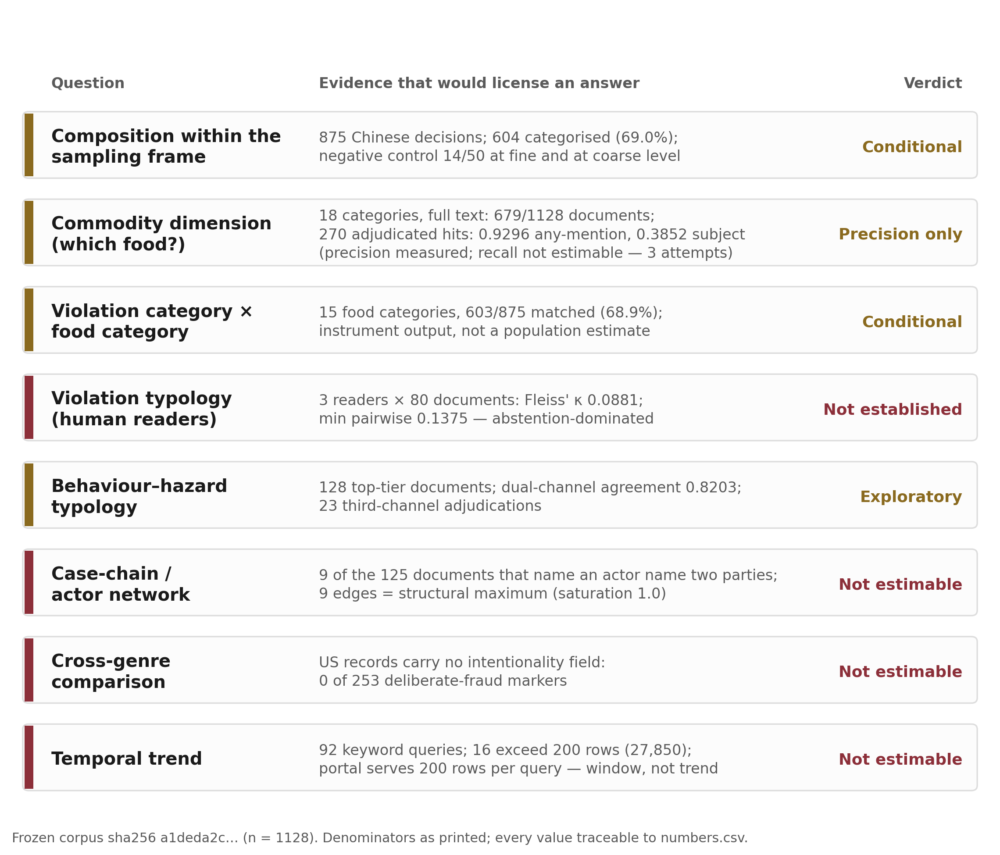

# What Chinese Food-Safety Penalty Records Measure: An Audited Baseline, a Commodity-Term Audit, and an Estimability Ladder

Yongjin Chen^1^, Chenrui Yang^1^, Ziying Xue^1^, Xiyuan Wang^1^ and Songze Zhu^1^,\*

^1^ People’s Public Security University of China, Beijing, China

\* Correspondence: 20196846@ppsuc.edu.cn

**Article type:** Article (Foods)

---

## Abstract

Administrative penalty decisions are the most abundant machine-readable record of food-safety enforcement in China, yet they have not been validated as a measurement instrument. On a frozen corpus of 1,128 documents (875 Chinese decisions, 253 US recalls), a deterministic statute map assigns a coarse violation category to 604 of the 875, and a two-channel language-model layer reaches 0.7460 agreement and a statute-anchored micro-F1 of 0.7825 on 423 anchors, but only 0.4195 macro-F1 over classes with support of at least 20. Because the rule layer agrees with the independent channel on 14 of 50 documents at both granularities, distributions are reported as the output of a documented instrument rather than as population estimates. The food dimension this literature assumes is audited next: a pre-registered 18-category lexicon matches 679 of 1,128 documents; adjudicating 270 hits yields any-mention precision 0.9296 but subject-matter precision only 0.3852, because most terms occur in ingredient lists or quoted statute. Three readers of the violation typology reach Fleiss’ κ = 0.0881. Three pre-registered attempts to recover the commodity role for every document fail the same pre-fixed gate (best κ 0.4885, balanced accuracy 0.7390, against 0.60 and 0.75), so that axis is reported in precision only and its recall is not estimable. Composition within the sampling frame is therefore reportable with its instrument attached; prevalence, trend and case-chain structure are not.

**Keywords:** food fraud; administrative penalty documents; measurement validity; commodity audit; estimability; automated annotation

---

## 1. Introduction

### 1.1 The record and the problem

Food-safety fraud often takes a documentary form. Forged inspection reports, mislabelled ingredients, borrowed certification marks and fabricated traceability records attack the informational layer on which food-safety regulation relies, and they do so without necessarily producing a hazardous product. Scholarly attention to this class of conduct has not produced a commensurate empirical base: most studies rely on case collections, inspection statistics or survey instruments, each of which samples a different population and defines “fraud” differently.

Administrative penalty decisions are one of the most abundant structured public records of these events in China. Enforcement agencies publish decisions containing the legal basis invoked, a narrative of facts and the sanction imposed. For research purposes the record has two attractive properties: it is produced for legal rather than scholarly purposes, so its categories are not researcher-imposed; and it is large enough to support distributional statements if it can be processed at scale. For a food journal the question is narrower and more demanding than whether this record is structured: it is whether the food a case concerns can be read out of it at all.

### 1.2 Three obligations

Both properties come with obligations that the literature has not always discharged. Automated extraction from legal prose must be validated against something other than itself: agreement between two automated passes is a reliability statistic, not an accuracy statistic, and the two diverge sharply in our data. More consequentially, a genre constrains what can be inferred from it. A single-document penalty decision names the sanctioned party and the agency; it rarely describes the chain of intermediaries through which a forged certificate travelled. A publication portal that serves a fixed number of rows per query cannot support a prevalence estimate, however many documents it contains.

A third obligation is specific to a food journal. Studies of food fraud want to know *which foods*; a text pipeline can only supply that if the food dimension is measured rather than assumed. Lexical food categories are usually attached to such corpora without any audit of what a match means — yet a term that occurs in a case is very often not the commodity the case is about. An ingredient list in a mislabelling decision mentions six commodities, and a quoted statutory provision mentions several more; both inflate a “food category” count while adding nothing to the question a food scientist is asking.

### 1.3 Related work

Four strands of work bear on what this record can measure. None of them closes the question.

**What food fraud is, and what can be counted.** Food fraud is defined by intent — deception for economic gain — rather than by hazard, and that definitional choice fixes what any count of it means [8]. The most systematic record-based evidence is a curated database of food fraud records extending back four decades, which supports statements about the composition of recorded incidents while remaining a record of what was detected and entered rather than of what occurred [9]. For China specifically, enforcement data have been analysed in a data-driven preprint that reports distributions over violation records [1].

**Enforcement documents as evidence.** A second strand treats enforcement documents as the object of study rather than as its by-product. Chinese work uses violation records together with institutional covariates — regional character and restaurant size, regulatory decentralisation, street-level organisational capacity — and asks about enforcement behaviour rather than about what the documents measure [3,4,5]. Comparable work reads published judicial decisions and documented enforcement records in other jurisdictions for a national picture [10]. A cross-country comparison locates the variation in meso-institutions across regimes, comparing constructs rather than rates and never asking whether two record genres can support a common one [7]. A legal-doctrinal literature asks whether penalty decisions should be disclosed at all, without measuring their content [6].

**Automated annotation and what validates it.** Where enforcement text is coded at scale, the question becomes what licenses the codes. Legal-text analytics has been applied to food-violation judgments — 782 Indian cases from 2022–2024 — and reports composition counts without a validation layer [2]. Work on large language models as annotators has begun to characterise when their labelling decisions move with contextual cues [11], which matters here because the same model plays both the annotating and the judging role in a two-channel design. The distinction the present study turns on is that agreement between two automated passes establishes reliability and says nothing about accuracy; the two diverge sharply in our data.

**The commodity dimension.** Food-fraud research is organised around commodities and supply-chain nodes, and prevention is built on vulnerability assessment, which has converged on common procedures for managing and mitigating fraud risk [12]. Yet when a text corpus is given a food dimension, the categories are usually attached by lexicon and reported without an audit of what a match denotes. We located no study that reports an adjudicated precision for the food dimension of an enforcement corpus, and none that separates the commodity a case is about from the commodities the document merely mentions.

**The gap.** Taken together the four strands leave one question open: whether the text of penalty decisions can be used as a measurement instrument at all, and what its food dimension actually denotes. That is the question this paper answers, and it answers it by auditing rather than by assuming.

### 1.4 This paper

This paper reports a baseline built under those three obligations, and it is organised around what the record can carry rather than around what a classifier can output. We describe a fully automated pipeline and report its measured performance, including where it fails. We audit the commodity dimension directly and report what a commodity term in these documents actually denotes. Finally, we report the joint distribution of violation category and food category that the record does support, while marking three questions it cannot answer and stating the measurement reason for each. We deliberately do not claim national prevalence, we do not describe change over time, and we do not compare fraud rates across jurisdictions, because in each case the instrument or the sampling frame, not the phenomenon, would be doing the work.

The result is a ladder, and the ladder is the contribution: composition within the sampling frame is reportable with the instrument attached; the commodity dimension is measurable in precision; prevalence, trend and case-chain structure are not estimable, each for a reason that is itself measured rather than asserted.

## 2. Materials and Methods

### 2.1 Sources and sampling frame

Chinese documents were collected from the national food-safety penalty publication portal operated under the State Administration for Market Regulation. Collection was driven by 92 keyword queries built from the project’s fraud lexicon (forged, mislabelled, misuse of certification marks, tampered, substandard, unlicensed, and their combinations with “food”). The portal returns results in publication-date-descending order and serves at most four pages of fifty rows per query. Both properties are recorded as a product rather than asserted (`data/reports/portal_mechanics.json`, 2026-11-05T04:54:41Z): across three queries, pages 1–4 returned 50 rows each and pages 5 and 6 returned zero; the 50 publication dates on page 1 of one query ran from 2026-10-19 down to 2026-09-30 with no increase anywhere in the sequence, and page 4 of another query ended at 2026-01-15.

This mechanics matters for interpretation and we state it in every results section that could be misread. Sixteen of the 92 queries reported more than 200 matching records, totalling 27,850 records, whereas no single query registered more than 201 documents in our corpus (counted per distinct document, which can exceed the 200-row ceiling when a document is reached on more than one page of the same query). The corpus is therefore best described as the union of the most recent 200-odd rows of each query under the portal’s default ordering. That is a documented, reproducible frame, but a recency-weighted one, and its coverage of any single query is a small fraction of that query’s matching population (174 of 6760 for one query, 88 of 5260 for another).

The document-level funnel is: 3,540 records entered the database; 2,091 were removed by the source-relevance screen; 296 were retained with metadata but no retrievable full text (`awaiting_pdf`); 25 were rejected at the annotation protocol stage; leaving 1,128 labelled documents — 875 Chinese penalty decisions and 253 US recall records. The 25 documents that had full text but failed the annotation protocol are longer than the labelled set: their median length is 6,136 characters against 3,578 characters for the 875 labelled Chinese documents, a ratio of 1.71 measured on the same column of the same database. The 296 records without full text have no length at all — they never received text — so they are reported as missing rather than as long, and we return to both exclusions in Section 5.

English-language documents are 253 recall records from the openFDA food-enforcement database, used only for the composition comparison in Section 3.8. They are a different genre: a recall record classifies a hazard and a recalling firm, and has no field for intentional falsification.

### 2.2 Deterministic layer

Two rule systems run before any model. A statute-to-category map (version 2) assigns each document to one of nine fine-grained categories, which collapse deterministically into five coarse categories: data falsification (forged inspection report, tampered traceability, fake certification, false labelling), market order (trademark infringement, false advertising, product quality), unlicensed operation, procedural non-compliance, and undetermined. A food-category lexicon (version 1) assigns up to one primary and several secondary food categories from a 15-category vocabulary plus an unmatched bucket.

Both rule systems read only the penalty-clause paragraph and the fact paragraph, never the full document: the boilerplate that surrounds a decision mentions statutes and food terms irrespective of the case, and matching on full text inflates every count. Section 2.5 quantifies how much it inflates.

The deterministic layer was cross-checked against the LLM layer on a random 50-document slice (seed 20261104). This is an agreement check and not a validation: the LLM layer is the same model under a different prompt, not an independent gold standard, and no human annotation of these categories exists. Exact-category agreement was 0.28 against both LLM channels, compared with a same-model cross-channel agreement of 0.74 on the same slice — so the deterministic layer agrees with the LLM layer far less than the LLM layer agrees with itself. The pre-registered fallback rule said that a dimension with agreement below 0.75 should be reported only at the coarse level, which presumes that fine-grained disagreement largely collapses into agreement at the coarse level. We tested that presumption on the same slice with the already-frozen coarse map: it does not hold. The same 14 of 50 documents agree at fine and at coarse granularity, agreement conditional on the rule having decided anything is 14 of 32 (0.4375), and the 18 documents the rule declines to classify are all disagreements. Coarse reporting is therefore not validated either, and Section 3.2 reports the distribution as instrument output with the negative control attached rather than as an estimate.

### 2.3 LLM annotation layer

Annotation uses a locally served Qwen2.5-7B-Instruct model through vLLM, with two independently prompted channels (A, α-prompt; B, β-prompt) that label six entity types (service provider, end user, tactic, document, jurisdiction, penalty event) and a violation category. Input text is capped at 20,000 characters (no document exceeded the cap; labelled median 3,151, p99 9,705 characters here, against a median of 3,578 on the document-length column used in Section 2.1 — two different columns, not two measurements of the same quantity). Answer budgets were 3,000 and 4,000 tokens. Spans match at a character-level threshold τ = 0.5.

Agreement between the two channels is 0.7460 over the full corpus (n = 1128), 0.7257 for Chinese and 0.8158 for English documents, and pooled micro-F1 0.7442. τ-sensitivity is flat (0.7487 at τ = 0.3, 0.7460 at τ = 0.5, 0.7276 at τ = 0.7). A pre-registered single-pass protocol — one pass per document, no self-consistency, no ladder — gives 0.6966 on the 1,037 documents for which a single-pass vote exists (the pre-registered figure is reconstructed for 638 of those documents from archived single-shot channel outputs, and 91 had no archived copy and are excluded rather than imputed).

The annotation pipeline includes a type-shrinkage ladder: entity types are retained only if their per-type F1 reaches 0.75 with support of at least 20. Three types survive (END_USER, JURISDICTION, PENALTY_EVENT) and agreement on the restricted type set is 0.8610. All three of the present numbers — 0.7460, 0.8610 and 0.6966 — measure different things and are never substituted for one another.

### 2.4 Statute-anchored evaluation

Agreement between two LLM channels cannot establish accuracy, so we built an anchor set: 423 documents in which the penalty clause cites a statute that appears in the mapping table. The anchor is external to the LLM channels and legible from the statute itself, but it is not independent of the deterministic layer, which reads the same penalty clause; it therefore measures the LLM channel and yields no accuracy estimate for the deterministic layer. A further 97 documents cite a statute but carry no rule-legible fact paragraph and are excluded from the anchor set; the exclusion is recorded in the evaluation product rather than dropped silently. Anchors are drawn from three bases: a penalty statute (232 documents), a cited statute (52) and a statute plus explicit facts (139). This set yields micro-F1 0.7825, macro-F1 over all classes 0.2693, and macro-F1 over classes with support ≥ 20 of 0.4195.

Per-class performance is deliberately reported with support and prediction counts, because the macro figure is otherwise unreadable: FALSE_LABELING F1 0.8801 (support 326, predictions 383); UNLICENSED_OPERATION 0.3784 (52, 22); FORGED_INSPECTION_REPORT 0.3571 (11, 17); OTHER 0.0 (31, 0). Two classes have support below 3 and contribute zero. The zero for OTHER is not a rounding artefact: the instrument issued no OTHER predictions at all against 31 anchored documents.

### 2.5 Commodity-term audit

The food dimension of this corpus had never been measured, so we measured it. The audit is a document-level, literal presence test over the cleaned full texts of all 1,128 documents, not a classifier. Its lexicon of 18 commodity categories — grains and their products, edible oils, fresh meat, meat products, aquatic products, eggs, dairy, vegetables, fruit, soy products, bakery, alcoholic drinks, beverages and frozen desserts, tea, condiments, health food, confectionery and roasted nuts, and foods for special dietary uses — was fixed and registered before any count was taken, and the term list was not edited afterwards. Matching is a substring test on the raw text with no tokenisation, no regular-expression wildcards and no case or variant folding, which is the simplest rule that can be re-executed by a reader; Section 3.3 reports what that simplicity costs.

Two properties of the design matter. First, the unit is the document, and the value is whether at least one term of a category occurs anywhere in the document, including its header: the measure says “this document mentions the category”, never “this case concerns it”. Second, absence means only absence of the string. A document that names a brand, an alias or only the violation will be counted as absent, so no category may be read as a denominator of non-occurrence.

To measure what a match means, we adjudicated a sample drawn by a rule fixed in advance: within each category, documents were sorted by the sha256 of their identifier and the first fifteen were taken (270 documents in total; every category had at least fifteen hits, so the sample is equal-allocation and is not proportional to category size). The draw is deterministic rather than random, so the interval quoted for each precision is a binomial approximation — an indication of sampling noise, not a design-based confidence interval. Each sampled hit was read in a ±120-character context window, and the full document where the window was not decisive. Every hit was assigned one of four verdicts: **subject**, the term names the commodity the case is about; **mention**, the term occurs but not as the case subject (ingredient list, menu component, business scope, neighbouring product); **statute**, the term occurs only inside quoted law or standard text, which is a subset of mention recorded separately; and **false**, the term does not refer to that food category at all — a place or company name, a homograph, or a cross-word-boundary artefact such as the string for “peanut” formed by “osmanthus” plus “production”. The registered pass test counts subject, mention and statute as passes; two precisions are reported and neither is called “the precision” on its own.

A negative control of three non-food terms (battery, boiler, platform scale), known from the corpus to occur, is reported alongside: it detects a lexicon that fires on unrelated text, and it also tells a reader whether the corpus is purely food-related.

Because this audit measures precision only, we also tried to obtain the commodity role for every document, which is what a recall figure would require. Three constructs were registered on the deviation register before they ran, against a gate fixed before the first model call: agreement with the same 270 adjudicated items of at least κ 0.60 and balanced accuracy of at least 0.75, both chosen because the gold is imbalanced. The three constructs are a forced 18-way choice, eighteen per-category yes/no questions, and free-text extraction of the product name followed by a deterministic mapping through the same frozen lexicon. The third registration carried a cap: no further construct, model or format would be attempted after it. Section 3.4 reports all three, including the one that came closest, and the reason the gate was not moved to meet it.

### 2.6 Human reliability check of the violation typology

Six violation categories had never been checked against human readers either. Three readers — three separate administrations of the same codebook through the same session channel, so `n_coders = 3` and not three independent research teams — coded the same 80 documents. Fleiss’ κ over the three readers is the primary statistic, computed with a verdict rule fixed before the result was seen: a minimum pairwise agreement of 0.80 with a Wilson lower bound of 0.70 and Fleiss’ κ of 0.60 would support a shared reading; κ below 0.40 or a minimum pairwise agreement below 0.60 would support its absence. Because κ counts a pair of abstentions as an agreement, we also decompose each pairwise agreement into agreements in which both readers declined to classify and agreements on a substantive class.

### 2.7 Reproducibility

The pipeline is a single command set with per-stage receipts; the corpus is frozen and content-addressed; and every statistic quoted in this paper is generated by a script that records the product file, the JSON field, the product timestamp and the product’s sha256 into a machine-readable sheet. Design deviations discovered during execution, including every one that affected a reported number, are kept in an append-only register shipped with the supplementary material (`DEVIATIONS.md`). The provenance sheet that licenses every number in this paper is shipped alongside it (`numbers.csv`, each row naming a product path, JSON field, product timestamp and product sha256). We treat that register as a result, not as housekeeping: it is the evidence that the reported numbers were not selected after the fact. The register also records its own corrections, including that two consecutive new entries were first written under numbering already in use and were reassigned by a later entry rather than silently renumbered. Analyses run after the corpus was frozen name their input file, and the chain resolves to the frozen corpus: the negative-control product reads the E6 product, which stamps `silver.sha256 = a1deda2c…` and `n = 875`. A post-freeze analysis that weakens a claim rather than strengthening it — as the coarse-granularity negative control and the commodity audit both do — is reported for the same reason.

## 3. Results

### 3.1 The measurement layer, with what each number measures

Table 1 summarises the measurement layer and is the paper’s spine: every subsequent claim is licensed by a row of it or is not made. Per-type F1 separates cleanly: END_USER 0.9105, JURISDICTION 0.8809 and PENALTY_EVENT 0.8606 are extracted consistently by both channels, while TACTIC (0.6279), DOCUMENT (0.4097) and SERVICE_PROVIDER (0.3356) are not. These are agreement figures, not correctness figures: no human adjudication of entity spans exists for this corpus, so consistency across two renderings of the same model is the strongest statement the per-type line can support. This is why the case-chain analysis in Section 3.7 fails for a measurable reason: the two entity types that a chain requires — the service provider and the document that was forged — are precisely the two the instrument cannot extract reliably.

At the category level the same pattern holds. A single dominant category (FALSE_LABELING, 326 anchors) is recovered well; rare categories are not; and the residual class is never emitted. Macro-F1 over all classes (0.2693) is therefore not a statement about the instrument — it is dominated by two classes with support 1 and 2 — while macro-F1 over classes with support ≥ 20 (0.4195) is the more informative one. That figure still averages a structural zero: OTHER has support 31, receives no predictions, and enters the mean as 0. Dropping the never-emitted class raises the same statistic to 0.6292. We report all three (0.2693 / 0.4195 / 0.6292), always with the class list, because the gap between the last two is a property of the threshold and the instrument’s vocabulary rather than of its accuracy, and reporting one of them alone would hide that.

### 3.2 Coarse composition of the Chinese corpus, as instrument output

Of 875 Chinese documents, 604 (0.6903) received a coarse category from the deterministic layer (Table 2). Data falsification was assigned to 412 (68.2% of categorised documents, 47.1% of all documents), market-order violations to 100, procedural non-compliance to 66 and unlicensed operation to 26. That coarse class is not homogeneous, and the composition matters for what the label means: 375 of the 412 are false labelling (0.9102), 33 forged inspection reports and 4 fake certification. The headline category therefore describes documentary mislabelling much more than forgery, and we report its composition here rather than letting the class name carry an interpretation it does not support. Every figure in this section is the output of that layer; the negative control for the layer is 14 of 50 documents at both fine and coarse granularity (Section 2.2), so the numbers describe what a documented instrument assigns, and no statement about the prevalence of these categories in the population is made or implied.

The remaining 271 documents are undetermined: their penalty clause cites no statute in the mapping vocabulary, or cites a statute outside the five-category framework. Within this residual, 100 documents invoke no mapped statute at all, of which 19 invoke only the Administrative Penalty Law — a formal rather than substantive basis. We report the residual rather than force these documents into a category; a hard mapping would count conduct outside the construct as inside it.

Extractable fines are available for 565 of 875 documents, with a median of 5,000 CNY (p25 1,700; p75 15,000; p90 55,000; maximum 805,231). We report the distribution without modelling it: the sanction amount in these decisions is set by a statutory band whose lower bound depends on the value of the goods, which the decisions rarely state in a machine-readable way.

### 3.3 What a commodity term denotes: the audit

The commodity audit is the part of this study that speaks most directly to food research, and its result is a warning rather than a table of prevalence. Over all 1,128 documents, 679 contain at least one term from the 18-category lexicon and 449 contain none. The per-category counts are ordered by how often a category is mentioned at all, and they are not small: condiments appear in 163 documents, fresh meat in 137, grains in 111, aquatic products in 100 (Table 3).

Adjudicating the 270 sampled hits shows why those counts cannot be read as counts of cases about those foods. Of the 270 hits, 104 name the commodity the case is about, 121 are mentions in some other capacity, 26 occur only inside quoted statute or standard text, and 19 are outright false matches. Precision against the registered pass test is 0.9296 (95% CI 0.8927–0.9545) on an equal-allocation sample and 0.9404 when the categories are reweighted by their corpus size; subject-matter precision is 0.3852 (0.3291–0.4445) and 0.3636 respectively. The equal-allocation figures are not corpus proportions; the per-category columns are the primary result.

Three findings in that table are substantive for anyone who builds a food dimension onto enforcement text.

First, the 19 false matches are not semantic misjudgements and they are not one phenomenon; they fall into four textual kinds, and the split tells a builder what to fix. Seven are proper names: the place names Hulunbuir (呼伦贝尔), Shisun township and Pu’er (twice), and the company names Yuzhua Network and Nanjing Tai’er Sauerkraut. Four are cross-word-boundary substrings, where a term is assembled across a boundary the lexicon does not see: *jinguihua* + “production date” yielding the string for peanut; *miànbāochē* (“van”) yielding the bakery string for bread; *tǔdòugān* (“dried potato”) yielding the soy-product string for dried tofu; and the “copy” of a video disc yielding an aquatic-product character. Two are chemical names containing a fruit string — malic acid and glucono-delta-lactone. Six are flavour words — “strawberry milk flavour”, “grape milk flavour”, “blueberry yoghurt flavour”, “premium milk flavour” — in hard candy and cake products, which are not dairy in any sense a food scientist would accept. Word segmentation would remove the four boundary artefacts and still leave the names, the chemical names and all six flavour words; only a commodity-role test, such as the subject-matter verdict used here, removes all four kinds.

Second, two categories are almost entirely statutory. Of 15 sampled hits in health food, 4 occur only in quoted provisions; of 15 in foods for special dietary uses, 13 do. In this corpus those categories’ “presence” is largely a record of which decisions quote the article on foods for special dietary uses, and even their subject-matter counts are 1 and 1 out of 15 (precision 0.0667 in both). Condiments show the same pattern for a different reason: they are ubiquitous in ingredient lists, so 163 documents mention them while only 2 of 15 sampled hits are about a condiment as the product (precision 0.1333).

Third, the categories that survive the audit are the ones a food journal would actually want, and they survive at very different strengths. Soy products reach a subject-matter precision of 0.9333 and alcoholic drinks 0.8667: a case about soy products tends to be about soy products. Bakery reaches 0.6000 and meat products 0.6000. Dairy, fruit, fresh meat and grains sit between 0.2000 and 0.3333, because a meat or dairy term in a mislabelling decision is usually the ingredient that was mislabelled rather than the product that was sold.

The negative control confirms the corpus is not purely food-related: the three non-food terms occur in 2, 2 and 1 documents, and 3 documents contain a non-food term and no commodity term at all. That is a fact about the corpus’s composition, not an estimate of how much of it is off-topic.

Word segmentation does not rescue the lexicon, and the test that shows it is cheap. Re-running the same 18 term lists under a rule that counts a term only when both ends of the hit fall on a token boundary (jieba 0.42.1, default mode, no user dictionary) moves the corpus total from 679 documents to 634, with no document gained: the segmented rule is a strict subset of the literal one. On the 270 adjudicated hits it drops 38 — 8 of the 19 false matches, which is what segmentation is for, and also 12 of the 104 true subjects. Subject-matter precision moves from 0.3852 to 0.3966 (92 of 232), a gain of 0.0114. The losses concentrate in short terms, where jieba’s token is the longer word: the term for fish is lost in 52 documents because *carp* and *squid* are single tokens, and a case about carp is a case about an aquatic product. Segmentation is the right repair for the four cross-word-boundary artefacts and the wrong repair for the problem that dominates the table.

### 3.4 Can the commodity role be automated? Three attempts, three registrations, no pass

The audit in Section 3.3 measures precision and nothing else. Recall, the share of cases about a given food that the lexicon recovers, needs the subject of every document rather than of 270 sampled hits. A lexicon that matches literal category terms cannot supply it: a decision that names only a brand, an alias or a product type outside the term list is invisible to it. We therefore tried to obtain the subject by asking a served 7B model, under a gate fixed before any call was made: agreement with the 270 adjudicated items of at least κ 0.60 and balanced accuracy of at least 0.75, because the human gold is imbalanced (104 of 270 are subjects) and raw accuracy would reward a model that answers “no” everywhere.

The three attempts are three different constructs, not three settings of one. E13 asked the model to pick one of the 18 categories (forced choice, 18-way). E15 asked 18 separate yes/no questions of the same document, one per category. E16 asked the model to write the product name in free text — at most twenty characters — and left the mapping to the 18 categories to the same frozen lexicon, in code, identically for every document. Each was registered before it ran, and the third carried a cap fixed in advance: no further construct, model or format would be tried after it. The cap bounds this pipeline and not the class of models — a different model is a different instrument and would require its own registration. All three failed the gate (Table 4).

Three things follow, and the first is that these are not three measurements of one failure. The best κ and the best balanced accuracy are E15’s; the best specificity is E16’s; the best sensitivity is E15’s. Changing a forced choice into per-category binaries moved κ by +0.1644 and sensitivity by +0.1923 while specificity barely moved (−0.0180). A substantial part of E13’s blindness to true subjects was therefore produced by the format, since a model forced to pick one of eighteen categories will answer rather than abstain. That is not enough of the effect for the question to survive, because 0.4885 is far from 0.60 and 0.7390 is below 0.75. The format is a real variable; it is not the explanation.

E16 fails at a different place, and saying where is the point of running it. The model wrote a product name for all 1,128 documents and declined in 232. The names it wrote are recognisable commodities — 牛栏山陈酿酒, 黄桃罐头, 贵州茅台酒, 秘制红油 — yet 818 of the 1,128 (0.7252) contain no lexicon term at all, so the deterministic mapping assigns them category 0 and they count as negative. The bottleneck there is *binding* — a literal category-term list cannot receive a brand name — not extraction. We did not hand-map those 818 phrases into categories after seeing the gate. Doing so would replace the instrument whose failure had just been measured with a different one, and it would not rescue the quantity at issue anyway: the gate tests whether the model identifies the subject, and all three attempts, including the one whose binding step we could have repaired, failed that test.

The consequence is a single sentence applied in the rest of this paper: **recall of the commodity axis is not estimable**, and no figure in it may be read as a share of cases. That is why Section 3.3 reports subject-matter precision per category and why its table is ordered by mentions rather than by a proportion of the corpus; why Section 3.6’s cross-tabulation is bookkeeping and not a finding; and why Figure 1 prints “measured” and “not measured” side by side on the commodity rung instead of one number. The 449 documents that contain no commodity term are the clearest case: an unknown share of them is about some food, none of them is invisible to a literal lexicon by accident, and no sample of them can be adjudicated by a single reader at the reliability this paper demands of three (Section 3.5). We register this as a negative measurement rather than as an open task, because a number produced by one reader on a task where three readers reached κ 0.0881 would enter the paper wearing the costume of a measurement.

### 3.5 Human readers do not share the violation typology

Because no human gold standard existed for the six violation categories, we built one and it failed. Fleiss’ κ over three readers coding the same 80 documents is 0.0881, with a minimum pairwise agreement of 0.1375; by the rule fixed in advance this is a verdict of no shared reading.

The pairwise figures must be read together, because they are not homogeneous. Readers A and B agree on 13 of 80 documents (0.1625, κ 0.0019); A and C on 64 of 80 (0.8000, κ 0.6371); B and C on 11 of 80 (0.1375, κ −0.0353). The A–C pair looks like a success until the abstentions are separated out: 42 of its 64 agreements are cases in which both readers declined to classify, and setting those aside the pair agrees substantively on 22 of 38 documents (0.5789). Readers A and C retreat to the residual category on 57.5% and 61.25% of documents, while B does so on 3.75%. The A–C κ of 0.6371 therefore cannot be used as a reliability coefficient for the typology, because κ credits mutual abstention as agreement. We report this rather than a single “agreement was low” sentence, which would have been true of two pairs and false of the third.

The consequence for the rest of the paper is stated once and applied throughout. The six-category typology is not jointly recoverable by three readers working from the same codebook on the same documents, so anything derived from it, including the behaviour–hazard sketch in Section 3.9, is reported as an exploratory instrument output and never as a human-validated category.

### 3.6 Joint composition of violation and food category

The deterministic layer’s own food axis — a 15-category vocabulary read only from the penalty and fact paragraphs, and a different instrument from the full-text audit in Section 3.3 — can be crossed with the coarse violation category. Of the 875 Chinese documents, 603 (0.6891) matched at least one of those 15 food categories and 272 fell in the unmatched bucket. The joint distribution is not uniform in either margin: in the instrument’s output, food additives (57 of 85) and prepackaged food (46 of 74) are dominated by data falsification, whereas alcohol is the outlier on the other side (24 of 63 market order, 9 of 63 data falsification). The full cross-tabulation is supplied as Supplementary Table S1 rather than typeset here; the margins quoted in this paragraph are all that the text relies on.

We report the contrast and do not interpret it, and Section 3.3 is the reason. With a commodity axis whose subject-matter precision is 0.3852, a row-level difference between food categories cannot be separated from a difference in how their decisions cite statutes and list ingredients. The tabulation is the bookkeeping, not the finding.

### 3.7 Three questions the record cannot answer

**Case-chain structure.** The main corpus contains 128 Chinese documents in the top confidence tier, 125 of which name at least one actor. Only 9 of the 125 that name any actor (0.072) name two or more distinct ones; 134 actor nodes and 9 edges are extracted. Since a document with one actor cannot produce an edge, the structural maximum for this corpus is 9 edges, and the extracted graph contains exactly that. Saturation of 1.0 is therefore an identity of the extraction rule — one edge per two-actor document — and carries no information about intermediation; we state it so that the number is not read as a finding. The network is not sparse because intermediaries are rare; it is complete with respect to what the documents permit.

**Temporal dynamics.** Survival and self-exciting-process analyses require dated events, and the corpus supplies zero usable event onsets; the gate returns inconclusive. We also decline the descriptive trend that the year distribution invites. Because the sample is the union of per-query, publication-date-ordered top rows, its year composition reflects the portal’s ordering and the date of collection, not enforcement activity. No statement about increasing, decreasing or accelerating enforcement is made anywhere in this paper.

**Differential comparison across enforcement profiles.** A pre-registered comparison of violation profiles between the two jurisdiction samples returns not estimable: with a modal category share of 0.945 on one side, the contingency table is degenerate and the Fisher test is uninformative (p = 0.258).

### 3.8 Cross-genre composition, not a cross-jurisdiction rate

The comparison below is between two genres, and it is reported as such — and reported rather than dropped, because the frame-dependence of the odds ratio is itself the result: a reader shown one frame would take a coding artefact for a rate. On the Chinese side 438 documents fall inside the **fraud framework** — the four categories the comparison admits: false labelling 375, forged inspection report 33, unlicensed operation 26, fake certification 4. The other 437 Chinese documents are outside it for two different reasons: 271 are undetermined (no mapped statute in the penalty clause), and 166 fall in the two coarse categories the framework does not carry (market order 100, procedural non-compliance 66). Stating only the undetermined exclusion, as a shorter sentence would, misdescribes the denominator by 166 documents. On the US side all 253 recall records fall inside the framework, 156 of them only into the residual class.

Because the frame is the analyst’s choice, the contrast is reported under three frames. As defined: OR 9.57 (95% CI 6.63–13.83; p = 2.16 × 10⁻³⁷). Counting the 166 framework-excluded Chinese documents as non-false-labelling: OR 2.63 (1.95–3.56; p = 2.07 × 10⁻¹⁰). Removing unlicensed operation from the Chinese side: OR 16.30 (10.69–24.86; p = 3.20 × 10⁻⁴⁸). The direction and the significance survive every frame; the magnitude moves by a factor of six, so the odds ratio is reported with its frame and not as an effect size. Cramér’s V (0.7207) and the χ² companion statistic (358.9) are computed on the five-category table rather than on the collapsed one and describe the same table; the minimum expected count is 1.465, which is why the Fisher test rather than the χ² carries the inference.

The test is statistically unambiguous and inferentially empty, and we say so in the same breath. The US record contains no field for intentional falsification: the count of records with an explicit deliberate-fraud marker is 0 of 253. A comparison of “false labelling” shares between a genre that codes labelling violations and a genre that does not is a comparison of coding schemes. We therefore return an estimability verdict of instrument mismatch and report the table as a description of what each record type records.

### 3.9 Behaviour–hazard sketch, exploratory

On the 128 top-tier Chinese documents, dual-channel agreement for the behaviour–hazard codebook is 0.8203, with 23 documents requiring third-channel adjudication; 49 codebook entries were generated. Consumer deception is the dominant hazard (107 documents) against food-safety hazard (19), and mislabelling (117) dominates forged reports (52) as a tactic. These are multi-label counts over 128 documents and the whole section is exploratory: at this sample size a 0.82 agreement supports a typology sketch, not a distribution. Section 3.5 states why the category axis underneath it cannot be treated as human-validated.

### 3.10 Figure 1 — the estimability ladder

Figure 1 places each research question against the evidence that licenses it: composition within the frame (conditional — instrument output, negative control 14/50); the commodity dimension (precision only — subject-matter precision 0.3852 on 270 adjudicated hits, with recall not estimable after three pre-registered attempts); joint composition with food category (conditional, 68.9% matchable); violation typology by human readers (not established — Fleiss’ κ 0.0881); behaviour–hazard sketch (exploratory, n = 128); case-chain structure (not estimable: 9 of 128 documents, saturation 1.0); cross-genre comparison (not estimable: instrument mismatch); temporal trend (not estimable: sampling window). The figure’s purpose is procedural: a reader can see, before reading a number, whether the number is licensed.

{width=100%}

---

```{=latex}
\newpage
```

**Table 1.** Measurement layer: what each statistic measures, on which denominator, from which product.

| Statistic | Value | Denominator | What it measures | Product |
|----------------|------:|----------|----------------------|----------------------------------|
| Two-channel agreement (post-ladder mix) | 0.7460 | 1128 | reliability, not accuracy; mixes 729 self-consistency and 399 single-shot documents (e1 status: failed, < 0.75) | `data/metrics/e1.json` |
| Same, stable types only | 0.8610 | 1128 | reliability on 3 of 6 types | `data/metrics/e1.json` |
| Pre-registered single-pass agreement | 0.6966 | 1037 (91 lost) | reliability, no ladder | `data/metrics/e1_preladder.json` |
| Anchor micro-F1 | 0.7825 | 423 | accuracy vs statute anchors | `data/metrics/e1.json` |
| Anchor macro-F1, classes with support ≥ 20 | 0.4195 | 3 classes, pooled support 409 (326 + 52 + 31) | accuracy, excluding unlearnable classes | `data/metrics/e1.json` |
| Anchor macro-F1, all classes | 0.2693 | 423 (6 classes) | dominated by support 1–2 classes | `data/metrics/e1.json` |
| Rule vs LLM agreement (cross-check) | 0.28 | 50 | agreement with one LLM channel; not a validation | `data/analysis/e6_descriptive.json` |
| Commodity term presence, any-mention precision | 0.9296 | 270 adjudicated hits | does a matched term denote that food category at all | `data/analysis/e12_commodity_precision.json` |
| Commodity term presence, subject-matter precision | 0.3852 | 270 adjudicated hits | is that commodity the product the case is about | `data/analysis/e12_commodity_precision.json` |
| Violation typology, three readers | 0.0881 | 80 documents × 3 readers | Fleiss’ κ; shared reading not established | `data/analysis/e11c_three_coder.json` |

**Table 2.** Coarse violation composition of the Chinese corpus, and the composition of its dominant class (n = 875; frozen corpus `a1deda2c…`). Every count is the deterministic layer’s output; the negative control for that layer is 14 of 50 documents at fine and at coarse granularity alike.

| Coarse category | Documents | Share of categorised | Composition |
|----------------------|---------:|---------------|--------------------------------------------|
| Data falsification | 412 | 0.6821 | false labelling 375, forged inspection report 33, fake certification 4 |
| Market order | 100 | 0.1656 | trademark infringement, false advertising, product quality |
| Procedural non-compliance | 66 | 0.1093 | no mapped substantive statute |
| Unlicensed operation | 26 | 0.0430 | unlicensed production or operation |
| **Categorised total** | **604** | **0.6903 of 875** | — |
| Undetermined | 271 | — | 100 cite no mapped statute, 19 only the Administrative Penalty Law |

**Table 3.** Commodity-term audit. Presence is a literal substring match over the cleaned full text of each document (n = 1,128); precision is measured on the first 15 documents of each category in sha256(identifier) order, read in ±120-character windows and adjudicated. “Any-mention” counts a match as a pass when the term denotes the category in any capacity; “subject” counts it only when the commodity is the product the case is about. Equal-allocation precisions are not corpus proportions.

| Commodity category | Documents with term | Sampled | Subject | Any-mention precision | Subject precision |
|--------------------|------------|--------:|--------:|--------:|--------:|
| Condiments | 163 | 15 | 2 | 1.0000 | **0.1333** |
| Fresh meat | 137 | 15 | 4 | 1.0000 | 0.2667 |
| Grains and their products | 111 | 15 | 4 | 1.0000 | 0.2667 |
| Aquatic products | 100 | 15 | 5 | 0.8000 | 0.3333 |
| Bakery | 86 | 15 | 9 | 0.9333 | 0.6000 |
| Confectionery and roasted nuts | 85 | 15 | 8 | 0.9333 | 0.5333 |
| Alcoholic drinks | 82 | 15 | 13 | 1.0000 | 0.8667 |
| Meat products | 72 | 15 | 9 | 1.0000 | 0.6000 |
| Edible oils | 70 | 15 | 3 | 1.0000 | 0.2000 |
| Fruit and fruit products | 69 | 15 | 3 | 0.7333 | 0.2000 |
| Health food | 66 | 15 | 1 | 1.0000 | **0.0667** |
| Beverages and frozen desserts | 56 | 15 | 8 | 1.0000 | 0.5333 |
| Vegetables and their products | 54 | 15 | 4 | 0.8000 | 0.2667 |
| Dairy | 49 | 15 | 5 | 0.7333 | 0.3333 |
| Eggs and egg products | 39 | 15 | 6 | 1.0000 | 0.4000 |
| Soy products | 35 | 15 | 14 | 0.9333 | **0.9333** |
| Foods for special dietary uses | 32 | 15 | 1 | 1.0000 | **0.0667** |
| Tea | 24 | 15 | 5 | 0.8667 | 0.3333 |
| **All categories** | **679** | **270** | **104** | **0.9296** (0.8927–0.9545) | **0.3852** (0.3291–0.4445) |

*Source: `data/analysis/e12_commodity_index.json` (at 2026-11-05T07:50:39Z, sha256 `52e3ca41…`) and `data/analysis/e12_commodity_precision.json` (at 2026-11-05T07:54:11Z, sha256 `11108382…`). **Three rows are not commodity spectra and are marked in bold: condiments (15), health food (16) and foods for special dietary uses (18) have subject precisions of 0.1333, 0.0667 and 0.0667 — their matches are dominated by ingredient lists and by quoted statute respectively, so only their subject counts may be read as cases about the commodity, and those counts are 2, 1 and 1 out of 15 sampled.** The 19 false matches are 7 proper names (place and company), 6 flavour words, 4 cross-word-boundary substrings and 2 chemical names, never semantic misjudgements; 26 further hits occur only inside quoted statute or standard text and are counted as passes under the registered rule. Three non-food control terms (battery, boiler, platform scale) occur in 2, 2 and 1 documents.*

```{=latex}
\newpage
```

**Table 4.** Three pre-registered attempts to identify the commodity a case is about, each validated against the same 270 adjudicated items and the same gate (κ ≥ 0.60 and balanced accuracy ≥ 0.75, fixed before the first call). The gate was never moved, and no attempt changed the gold standard, the corpus or the threshold.

| Attempt | Construct | κ | Balanced accuracy | TPR | TNR |
|-------|----------------------------|--------:|-----------:|-------:|-------:|
| E13 | forced choice, 18-way single selection | 0.3241 | 0.6519 | 0.4423 | 0.8614 |
| E15 | 18 per-category yes/no questions | **0.4885** | **0.7390** | **0.6346** | 0.8434 |
| E16 | free-text product name, mapped by the frozen lexicon | 0.3888 | 0.6766 | 0.4135 | **0.9398** |

*Source: `data/analysis/e13_commodity_subject.json`, `e15_validation.json` (sha256 `5b961f5c…`) and `e16_validation.json` (sha256 `0e560f5a…`); 270 items each, 0 unparseable, 0 duplicates, no document truncated at the 12,000-character cap. The three attempts differ in construct and, for E15 and E16, in whether the document precedes the question.*

---

## 4. Discussion

Five findings carry the paper; the last two speak most directly to a food-science readership.

First, an audited instrument is usable at whatever reliability it has, provided that reliability is stated. The joint tabulation of violation and food category places two axes in one table for Chinese food-safety penalty decisions. Its value is the bookkeeping rather than the ranking of food categories. A reader can see how many documents sit in each cell, how many were not matched to a food at all, and, because the negative control is printed rather than buried, that the layer which produced the table agrees with the independent channel on 14 of 50 documents.

Second, the headline agreement figure is not the result; its decomposition is. Two-channel agreement (0.7460) would have licensed almost any claim, and the anchor decomposition is what converts that licence into a boundary. The instrument is reliable and useful on three entity types and one dominant category, and unusable on exactly the two types a case-chain analysis needs. Reporting the macro figure over support-filtered classes, with the class list attached, converts an unusable score into a usable boundary.

Third, the commodity dimension is measurable and mostly not what it looks like. This is the result we would most want a food-science readership to take away: a lexicon that any research group could write in an afternoon produces category counts in the hundreds, and only 0.3852 of the corresponding matches are about that commodity. The distinction we introduce — any-mention versus subject-matter — is cheap to compute and changes what the table means. Without it, condiments and health food appear as prominent categories of Chinese food-safety fraud; with it, they appear as what they are in this genre, an ingredient list and a statute. We recommend that any study attaching a food dimension to enforcement or recall text report an adjudicated precision for that dimension, and report it separately for any category that can appear in an ingredient list.

Fourth, the commodity role is not recoverable by asking a general model nicely. Three constructs, registered in advance, each plausible on its own terms, all failed the same gate; the best of them missed κ 0.60 by 0.1115 and balanced accuracy 0.75 by 0.0110. The temptation, having seen that, is to adjust the second number — to lower a threshold, add a synonym list, hand-map the phrases the model wrote — and each adjustment would have produced a recall figure and destroyed the credibility of the exercise. We report the three failures as one finding because the comparison across constructs is the informative part: format mattered (sensitivity rose 0.1923 when the forced choice became binary questions), the mapping step mattered (818 of 1,128 extracted names carry no lexicon term), and neither mattered enough. A field that measures the food dimension of enforcement text should expect to buy recall with annotation, not with prompting.

Fifth, human agreement is not a formality. Three readers given one codebook and 80 documents produced Fleiss’ κ of 0.0881, and the pair that looked best (0.8000) was two-thirds mutual abstention. A paper that reported only the pair, or only the mean, would have claimed a validated typology. The abstention decomposition is what separates the two.

The estimability ladder in Figure 1 is the paper’s organising claim rather than a limitation section. For this genre, composition can be recorded, conditionally and by a documented instrument, while structure and dynamics cannot be estimated at all. The difference is a property of the documents and the instruments rather than of the analysis.

What would change the boundary is legible from the results. Case-chain structure requires decisions that name multiple parties — decisions on joint violations, or a linked case database keyed by legal person. Prevalence requires a portal export or a census of a closed population, not a paginated search. A commodity dimension of publication quality requires either an annotated sample at document level or a model trained on one; our audit supplies the first fifteen documents per category as a seed. Each is a data-collection problem with a known shape, which is why we state them as requirements rather than as caveats.

This audit bears on a further question without answering it. Work on illicit markets in compliance documents asks how such markets persist and reconstitute after enforcement — the resilience question, stated without a metric. Explaining why a forged-inspection network re-forms requires two things from an enforcement record: a time axis fine enough to separate a disruption from a recovery, and a link structure that identifies which parties return. These documents carry neither. The year composition is an artefact of portal ordering, and all but nine of the 125 actor-naming decisions name a single party, so the extracted graph saturates at the number of two-actor documents by construction rather than by finding. The contribution to that agenda is a boundary, and a specific one: before any coding effort is spent, it names which of the most abundant public records cannot supply the variables a persistence or re-entry analysis needs, and why. It bears in the same way on governance proposals that would rest on this record — monitoring a black market through its enforcement traces presupposes an instrument that the traces do not provide.

## 5. Limitations

The sampling frame is recency-weighted and covers a small fraction of each query’s matching population; composition statements are conditional on this frame and this collection date, and the year distribution is a property of the portal’s ordering (Section 3.7). Long decisions are under-represented in two distinct ways: 25 documents with full text failed at the annotation stage and are longer than the labelled corpus (median 6,136 versus 3,578 characters, 1.71×, on the same length column), and 296 documents never yielded text at all, so their length is unknown rather than short. The deterministic layer’s negative control — 14 of 50 at fine and at coarse granularity alike — means Table 2 is instrument output rather than a validated estimate, and the three-reader check in Section 3.5 means the underlying typology cannot be treated as human-validated either. The commodity lexicon is literal and unstemmed: it misses aliases and brand-only mentions, and its false positives are concentrated in word-boundary artefacts. The audit measures precision on 15 documents per category and measures no recall, so no absence statement is supported. Three pre-registered attempts to obtain that recall automatically failed the same gate (Section 3.4), which converts the missing recall from an unfinished task into a reported boundary. The anchor set is restricted to documents whose penalty clause cites a mapped statute, which over-represents formally coded conduct. The behaviour–hazard sketch is exploratory at n = 128 with 23 adjudications. Finally, English-side records carry no intentionality field, so no comparative rate is reported.

## 6. Conclusions

A fully automated, auditable pipeline can tabulate the coarse composition of food-safety violations in Chinese administrative penalty documents and attach denominators, product-level provenance and negative controls to every number; whether those tabulations estimate the underlying conduct is a separate question, and on the present evidence they do not. The food dimension, which a food journal is entitled to ask about, can be measured from the same documents — but only after an audit that separates the commodity a case is about from the commodities its ingredient lists and its statutes mention. The same documents cannot support prevalence, trend or case-chain statements, and the reason in each case is measurable. On the food axis specifically, the boundary is now drawn from evidence rather than from caution: three pre-registered constructs, from forced choice to free-text extraction, each failed the same gate, so identifying which commodity a case is about remains an annotation task. Reporting where an automated instrument stops being informative is as much a result as reporting what it measures.

---

## Appendix A. Exploratory self-training experiment (E9)

Design: QLoRA adapters (4-bit NF4 base, r = 16, α = 32, q_proj + v_proj, learning rate 1e-4, 3 epochs, gradient accumulation 8, greedy decoding) trained on the 228 top-tier documents’ high-confidence pseudo-labels, evaluated on the anchor set of Section 2.4, both arms under an identical document window.

Three properties of this experiment limit what it can say, and all three were found before any result was read.

First, the arms are not comparable with the main results. The document window is 5,192 tokens (a token budget), against a 20,000-character input cap on the annotation path. These are different units, and the appendix converts neither into the other. What matters is that the window is far shorter, so absolute F1 from this appendix is not comparable with the 0.7825 in Table 1; the two are never placed in the same table.

Second, the training and evaluation sets overlap. Of the 423 anchored documents, 112 (all Chinese) are also training documents, so a score over the full set mixes category learning with memorisation of pseudo-labels. The rule fixed before the run closed is that the primary figure is computed on the 311 documents the adapter never saw, with the full-set figure reported alongside as leakage-inflated and not used as evidence. The exclusion is a property of the design, not a selection on the outcome.

Third, the 311 documents are not a random subset — the excluded 112 are precisely the top-tier documents that happen to carry an anchor — so even the clean figure answers one narrow question, whether pseudo-label training transfers to anchored documents it has not seen, and does not generalise to the corpus.

Pre-registered criterion: a gain of 3 points or more in anchor macro-F1 on the clean subset is reported as a positive appendix result; anything less is reported as a null in one sentence. Two earlier runs were voided before any result was read, because the base arm was not rendered identically to the annotation path (49 of 50 answers unparseable); both are in the deviations register with the mechanism. A third run rendered the base arm correctly and completed all 423 of its generations, then stopped in the analysis stage: 27 of those generations could not be parsed into a category, the anchor scorer had already reduced them to `None`, and the comparison step raises on a `None` where it expects a category name. The defect is in the scoring path, not in the run, but the generation budget it consumed cannot be recovered, so the run is recorded as an abort and the pre-registered criterion was never evaluated. No appendix result exists, and this appendix is a design record: it states what the experiment was designed to establish and what would have licensed a claim, and it reports no number, because an F1 computed by repairing the scorer after seeing that it broke would not be the pre-registered quantity.

---

## Statements

**Author Contributions.** All authors have read and agreed to the published version of the manuscript. CRediT roles are to be assigned by the author team at submission.

**Funding.** Supported by 数据黑产“韧性”生成机制及治理对策研究 (Research on the Generation Mechanisms of and Governance Countermeasures for the “Resilience” of the Data Black Market), 25CSH113.

**Institutional Review Board Statement.** Not applicable. The study analyses administrative documents published by government agencies; it involves no human participants, human material or animals.

**Informed Consent Statement.** Not applicable.

**Data Availability.** The frozen corpus is released as a content-addressed document index (sha256 `a1deda2c…`), in which each record carries the agency, publication date and identifier needed to retrieve the document from the publishing portal; the source PDFs themselves are not redistributed. Alongside it the supplementary material carries the product files underlying every reported statistic, the deviation register and the pipeline source. The product files include the commodity index, its 270-document adjudication sample, the crosstab behind Supplementary Table S1, the three-reader coding files, the per-document predictions of the three automated attempts in Table 4, and the segmentation sensitivity of the lexicon. The bundle’s `MANIFEST.md` lists all twenty-five files with their sha256 and a verification block that checks every one. The corpus contains only documents published by government agencies; no personal data beyond what the publishing agency disclosed is included.

**Conflicts of Interest.** The authors declare no conflict of interest.

---

## References

*Titles, author lists, volumes, pages and years below were taken from the Crossref record for each DOI on 2026-11-05 and are reprinted as registered, not paraphrased; the record is shipped with the supplementary material as `refs_crossref.json`. No reference below is cited to support a number measured in this study.*

1. Gao, Q.; Huang, Y.; Liang, Q.; Sui, Y.; Zheng, Y. Food Safety Regulatory Enforcement in China: A Data-Driven Approach. *SSRN Electronic Journal* 2020. https://doi.org/10.2139/ssrn.3658748.
2. Joshi, S.; Basu, S.; Dey, L.; Das, P.P. LLM Driven Legal Text Analytics: A Case Study For Food Safety Violation Cases. *Proceedings of the 1st Workshop on NLP for Empowering Justice (JUST-NLP 2025)* 2025, 41–52. https://doi.org/10.18653/v1/2025.justnlp-main.6.
3. Sha, Y.; Song, X.; Zhan, J.; Lu, L.; Zhang, Q.; Lu, Y. Regional Character, Restaurant Size, and Food Safety Risk: Evidence from Food Safety Violation Data in Gansu Province, China. *Journal of Food Protection* 2020, 83, 677–685. https://doi.org/10.4315/0362-028x.jfp-19-457.
4. Lin, W.; Liang, J. Regulatory decentralization and food safety: evidence from China. *American Journal of Agricultural Economics* 2024, 107, 54–80. https://doi.org/10.1111/ajae.12484.
5. Yee, W.-H.; Liu, P. Governance capacity and regulatory enforcement: street-level organizations in Beijing’s food safety reform. *International Review of Administrative Sciences* 2021, 87, 256–274. https://doi.org/10.1177/0020852321992110.
6. 刘, 文静. Administrative Penalty Decision Disclosure Limit. *Dispute Settlement* 2022, 08, 424–430. https://doi.org/10.12677/ds.2022.83056.
7. Menard, C.; Martino, G.; de Oliveira, G.M.; Royer, A.; Schnaider, P.S.B.; Saes, M.S.M. How is food safety regulation implemented? The key role of meso-institutions assessed through a cross-country comparison. *Food Security* 2024, 16, 1045–1058. https://doi.org/10.1007/s12571-024-01461-0.
8. Spink, J.; Moyer, D.C. Defining the Public Health Threat of Food Fraud. *Journal of Food Science* 2011, 76. https://doi.org/10.1111/j.1750-3841.2011.02417.x.
9. Everstine, K.D.; Chin, H.B.; Lopes, F.A.; Moore, J.C. Database of Food Fraud Records: Summary of Data from 1980 to 2022. *Journal of Food Protection* 2024, 87, 100227. https://doi.org/10.1016/j.jfp.2024.100227.
10. Macheka, L.; Mubaiwa, J.; Nyarugwe, S.P.; Mugadza, D.T.; Chiwanza, T.Y.; Ntuli, V.; Manditsera, F.A. Food safety enforcement in Zimbabwe: Evidence from published judicial decisions and publicly documented enforcement records (1990–2025). *Food and Humanity* 2026, 7, 101354. https://doi.org/10.1016/j.foohum.2026.101354.
11. Vallejo Vera, S.; Driggers, H. LLMs as annotators: the effect of party cues on labelling decisions by large language models. *Humanities and Social Sciences Communications* 2025, 12, 1530. https://doi.org/10.1057/s41599-025-05834-4.
12. Barrere, V.; Everstine, K.; Théolier, J.; Godefroy, S. Food fraud vulnerability assessment: Towards a global consensus on procedures to manage and mitigate food fraud. *Trends in Food Science & Technology* 2020, 100, 131–137. https://doi.org/10.1016/j.tifs.2020.04.002.
